# my-driven-development (MDD)

**MDD es un plugin y una CLI para OpenCode V2 que convierte un pedido en lenguaje natural en un
cambio planificado, implementado y verificado contra los requisitos _y_ contra el plan.** Cada
etapa la ejecuta un subagente especializado, el usuario da su consentimiento con las preguntas
nativas de OpenCode, la evidencia queda guardada y el trabajo se puede retomar después de un
reinicio o desde otra conversación.

| | |
|---|---|
| Paquete | `my-driven-development` 0.1.0 (privado, no se publica en npm; se instala desde el checkout) |
| Host | OpenCode V2 **2.0.22** (`@opencode/plugin` y `@opencode/client` fijados a esa versión) |
| Node.js | **24.6+ dentro de 24.x**, o **26.4+ dentro de 26.x** (Node 25 no está soportado) |
| Memoria opcional | Engram **1.20.0** (viene apagada por defecto) |
| Idioma | La conversación, el asistente y la CLI hablan en español; los artefactos técnicos y los protocolos están en inglés |
| Estado | Implementado y cubierto por tests de contrato deterministas. **Todavía no hay validación end-to-end con modelos reales ni con la UI de permisos interactiva** (ver [Limitaciones](#limitaciones-conocidas-y-trabajo-pendiente)) |

---

## Índice

- [Puesta en marcha rápida](#puesta-en-marcha-rápida)
- [Qué pedirle a MDD](#qué-pedirle-a-mdd)
- [Prioridades del producto](#prioridades-del-producto)
- [Arquitectura general](#arquitectura-general)
- [Rutas de trabajo](#rutas-de-trabajo)
- [Actores (agentes)](#actores-agentes)
- [Preflight, modos y aprobaciones](#preflight-modos-y-aprobaciones)
- [Verificación y retrabajo](#verificación-y-retrabajo)
- [Workers paralelos y lotes de Apply](#workers-paralelos-y-lotes-de-apply)
- [Almacenamiento, memoria y el directorio `.mdd`](#almacenamiento-memoria-y-el-directorio-mdd)
- [Reanudar, transferir y propiedad de la ejecución](#reanudar-transferir-y-propiedad-de-la-ejecución)
- [Funciones independientes](#funciones-independientes)
- [Herramientas nativas `mdd_*`](#herramientas-nativas-mdd_)
- [Instalación en detalle](#instalación-en-detalle)
- [Configuración](#configuración)
- [Referencia de la CLI](#referencia-de-la-cli)
- [API de librería: kernel y `Workflow`](#api-de-librería-kernel-y-workflow)
- [Telemetría y privacidad](#telemetría-y-privacidad)
- [Estructura del repositorio](#estructura-del-repositorio)
- [Desarrollo y pruebas](#desarrollo-y-pruebas)
- [Límites y números clave](#límites-y-números-clave)
- [Historial reciente](#historial-reciente)
- [Limitaciones conocidas y trabajo pendiente](#limitaciones-conocidas-y-trabajo-pendiente)
- [Documentación de referencia](#documentación-de-referencia)

---

## Puesta en marcha rápida

1. **Requisitos:** Node.js 24.6+ (24.x) o 26.4+ (26.x), npm, Git y OpenCode V2 2.0.22.
   Si venís de OpenCode V1 y solo existe `tui.json(c)`, abrí OpenCode V2 una vez para que migre
   las preferencias a `cli.json` antes de instalar MDD. MDD no hace esa migración ni la saltea.
2. **Instalá MDD globalmente** desde el checkout del código:

   ```powershell
   npm run setup
   ```

   Si faltan las dependencias o el build, el lanzador pide un consentimiento aparte para
   `npm ci --ignore-scripts` y la compilación. Después abre el asistente en español
   (`Paso 1/4` … `Paso 4/4`). **No se escribe nada hasta que elegís _Aplicar_.**
3. **Reiniciá el servicio** cuando no haya trabajo en curso:

   ```powershell
   opencode service restart
   ```

   Recargar la configuración o cerrar solo la UI puede dejar cargado el módulo anterior del plugin.
4. **Abrí OpenCode en tu proyecto, elegí explícitamente el agente `mdd-orchestrator`** (no el
   agente por defecto) y escribí tu pedido.
5. *(Opcional)* Agregá el comando `mdd-ai` al PATH de tu usuario:

   ```powershell
   node "$HOME/.config/opencode/mdd/node_modules/my-driven-development/dist/cli.js" link
   ```

   Abrí una terminal nueva. A partir de ahí `mdd-ai` abre el mismo asistente desde cualquier
   directorio, y `mdd-ai doctor` diagnostica la instalación sin tocar nada.

> El proyecto donde trabajás no necesita ningún archivo de MDD: el plugin se instala una sola vez
> en `$XDG_CONFIG_HOME/opencode` (o en `~/.config/opencode` si XDG no está definido).

---

## Qué pedirle a MDD

El orquestador interpreta la intención del mensaje y elige la herramienta. Lo que escribís en el
chat es la fuente de verdad: MDD exige el texto nativo exacto del usuario y no acepta reescrituras.

| Lo que escribís (ejemplos) | Lo que hace MDD |
|---|---|
| "Agregá validación de email al formulario de registro" | Implementación nueva → protocolo adaptativo versión 3 (`mdd_adapt`) |
| "Quiero un módulo de facturación nuevo, pero preguntame todo antes de empezar" | [Sesión de preguntas](#sesión-de-preguntas-antes-de-la-admisión) por rondas (skill `mdd-grill`) antes de armar el contrato. Se ofrece sola cuando el pedido es grande y tiene muchas decisiones abiertas |
| "¿Cómo funciona el módulo de pagos?" | Pedido informativo → responde desde el contexto o con una investigación de solo lectura (`mdd_contextual_explore`). **Nunca** inicia una ejecución |
| "Continuá con el issue 42" | Primero busca ejecuciones previas (`mdd_status.workspaceRuns` y, si existe, la memoria Engram) y te dice dónde quedó y cómo retomarla |
| `Continue sourceSessionID=<id> runID=<id> here.` | Transfiere una ejecución desde otra conversación (`mdd_transfer`) |
| "Hagamos una revisión de seguridad" / "usa mdd-security" | Auditoría de seguridad de solo lectura (`mdd_security`) |
| "Run judgment-day on the complete committed change from `<base>` to `<target>`, including its tests and relevant dependencies." | Judgment Day: dos jueces ciegos más un corrector opcional |
| "Armá el cuerpo del PR" | Borrador del cuerpo del PR en español (`mdd_pr_body`). No hace commit, push ni abre el PR |
| "Hacé commit y push con ese cuerpo" | Entrega explícita con git/gh bajo tus permisos nativos. No es un objetivo nuevo, así que no repite el preflight |
| "Anotá que esto salió mal: …" | Registra una mejora (`mdd_improve`). Registrar no es arreglar |
| "¿Qué mejoras hay anotadas?" | Lista las mejoras registradas (`mdd_improvements`) |
| Después de un Verify fallido: "seguí igual" | Continuación explícita (`mdd_reset scope=continue`). El fallo queda registrado y **no** cuenta como PASS |

---

## Prioridades del producto

1. Empezar con un diseño o un plan útil.
2. Verificar la implementación contra **los requisitos y el plan**, no solo contra el código de salida de los comandos.
3. Tiempo y calidad son restricciones conjuntas: no agregar proceso que no ayude al resultado.
4. Los resúmenes para personas son simples, por compleja que sea la técnica.
5. El flujo ayuda al usuario a ir de A a B; no es una autoridad sobre el usuario.

En modo automático, un plan aprobado sigue adelante sin preguntas de continuación redundantes.
El modo interactivo explícito, los permisos nativos, los controles de alcance y los límites de
revisión siguen vigentes.

---

## Arquitectura general

MDD tiene tres puntos de entrada empaquetados: el **plugin de servidor** (motor y herramientas
`mdd_*`), el **plugin visual de terminal** (barra lateral y avisos) y la **CLI** (`mdd` / `mdd-ai`).

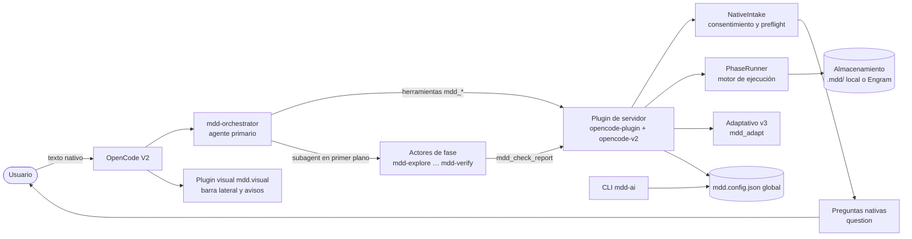

| Componente | Archivo de entrada | Responsabilidad |
|---|---|---|
| Plugin de servidor | `dist/opencode-plugin.js` (export `./opencode-plugin`) | Registra las 22 herramientas `mdd_*`, los hooks de OpenCode, el motor `PhaseRunner`, el intake nativo y el adaptador V2 (`opencode-v2.ts`) |
| Plugin visual | `dist/opencode-tui.js` (export `./opencode-tui`, id `mdd.visual`) | Barra lateral de fases (orden 250), avisos de transición y alertas. Solo presenta: no autoriza nada |
| CLI | `dist/cli.js` (bins `mdd` y `mdd-ai`) | Instalador, actualizador, doctor, editor de configuración, perfiles, telemetría, lecciones, retro y la prueba de ruteo |
| Kernel | `dist/kernel.js` (export `.`) | Evaluación pura y validada del ruteo (`evaluate`, `preflight`) |

### Cómo se protege cada actor

- **Instrucciones por valor:** `assets/opencode/mdd-instructions.md` se inyecta en cada prompt de
  fase junto con su ruta y su digest. Nunca se instala en el directorio compartido, así que ningún
  archivo con el mismo nombre puede reemplazarlo. Los `AGENTS.md` u otras instrucciones que el host
  agregue son información del repositorio, **no autoridad**: no agregan fases, no exigen skills y no
  relajan permisos.
- **Actores fijados:** los actores de fase se configuran con `task: false` y `skill: false`. Así no
  pueden delegar en otros agentes del registro compartido, y las skills aplicables se les ofrecen por
  ruta directa.
- **Herramientas exclusivas:** las herramientas `mdd_*` son del orquestador. Para el resto de los
  agentes están deshabilitadas en la configuración y se rechazan al ejecutarse.
- **Permisos:** el orquestador solo trae `question: allow`, lo justo para poder preguntar. Lo que
  cada actor puede hacer lo deciden tus permisos nativos de OpenCode.

---

## Rutas de trabajo

MDD conserva dos contratos de ruteo:

| Contrato | Entrada | Cuándo se usa |
|---|---|---|
| **Versión 3, adaptativo** (activo) | `mdd_adapt({ payload })` | Toda implementación nueva, incluidas las ediciones precisas |
| **Versión 2, fijo** (compatibilidad) | `mdd_start({ requirements })` | Entrada explícita de compatibilidad, más las ejecuciones históricas sin marca o fijadas en versión 2, que conservan su semántica original |

### Versión 3: low, medium y high adaptativos

La ejecución arranca con un **contrato compacto e inmutable**: objetivo, criterios de aceptación,
alcance exacto de lectura y escritura, exclusiones, decisiones, asignaciones y obligaciones de
evidencia. Si el contexto no se conoce, el coordinador puede investigar antes con
`mdd_contextual_explore` (solo lectura). Nunca inventa rutas ni arranca un escritor a ciegas.

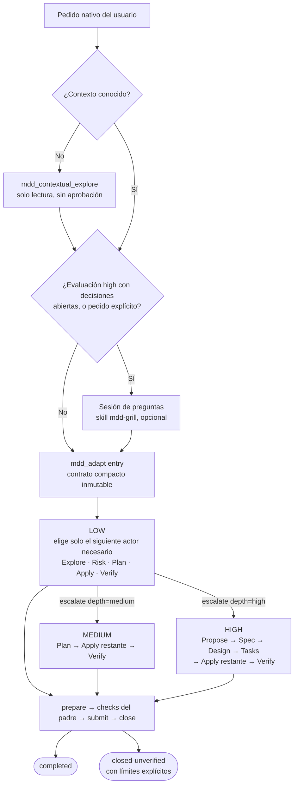

| Nivel | Actores | Qué es opcional | Requisito de cierre verificado |
|---|---|---|---|
| **Low** | Solo los necesarios, uno por vez. Valen "solo Apply" o "Explore y después Apply" | Explore, Risk, Plan y Verify se eligen según la necesidad | Cada asignación tiene una Apply aceptada y toda la evidencia exigida coincide |
| **Medium** | Plan genuino → Apply restante con alcance → Verify estructurado | Nada | Verify estructurado actual sobre todas las asignaciones, escenarios y decisiones |
| **High** | Propose → Spec → Design → Tasks → Apply restante → Verify | Nada | Igual que medium, más la secuencia de planificación completa |

Reglas clave de la versión 3:

- **Escalar** (`escalate`) congela una única profundidad, `medium` o `high`. Necesita impacto o
  complejidad positivos, una justificación explícita y un contexto acotado y entendido. El trabajo
  ya completado y válido se conserva: solo se rehace la Apply que falta o que quedó invalidada.
- **Los hijos están acotados:** no tienen shell, ni herramientas MCP o personalizadas, ni agentes
  recursivos. Solo Apply edita, y únicamente a través del editor acotado `mdd_worker_edit`.
- **Los checks reales los corre el padre** con sus permisos nativos. MDD registra la evidencia
  reportada; no certifica de forma independiente que el comando se haya ejecutado.
- **Cierre honesto:** `completed` exige evidencia actual y completa. `closed-unverified` exige
  límites explícitos y nunca cuenta como verificado.
- **Reparaciones:** como máximo 4 reparaciones de asignaciones completadas y 64 recibos de actor,
  sin reintentos automáticos ni alcance nuevo.
- **Ejecuciones terminadas:** no se reabren. Un turno genuinamente nuevo del usuario puede
  reemplazarlas en la misma conversación, después de archivar de forma inmutable el registro
  anterior y de hacer un CAS exacto de propiedad.
- **Modo:** el modo configurado se congela. Si no hay modo configurado, se pregunta solo el modo.
  En modo interactivo cada operación necesita una aprobación nativa real, de un solo uso. La
  pregunta (`Aprobación de operación`) está en español y nombra la operación en una frase; el
  detalle va en el chat, justo antes del formulario: en una entrada, el pedido, el resultado
  buscado y los archivos que puede escribir; al lanzar un agente, cuál, para qué tarea y con qué
  propósito. Solo `Aprobar operación` la autoriza; `Pausar`, `Rechazar`, el texto libre o
  descartarla no autorizan nada. Los recibos guardados antes de este cambio con
  `Approve operation` se siguen aceptando.
- **Preguntas cortas:** el formulario nativo de OpenCode no tiene scroll, así que cada pregunta de
  MDD es corta y su contexto (el pedido, los archivos, el "por qué importa", la razón de una ruta)
  viaja aparte, en `questionBrief`. El coordinador lo escribe en el chat tal cual y después hace
  la pregunta.
- **Sin topes de tamaño propios:** el contrato, la evidencia, el pedido del usuario y las listas de
  exclusiones y límites no tienen un tamaño máximo propio; solo aplica el límite total de 160000
  bytes por pedido. El prompt de cada agente adaptativo no se compacta ni se rechaza por tamaño, y
  Verify recibe los archivos de la instantánea por ruta y digest en lugar de su contenido.
- **Entrada mínima:** `entry` solo necesita el contrato. El host vincula solo el mensaje del
  usuario cuyo texto exacto es `contract.objective`; `messageID` es opcional y, si se pasa, tiene
  que coincidir. Las listas vacías (`exclusions`, `decisions`, `productQuestions`, dependencias de
  las asignaciones) y `context.fingerprints` se pueden omitir: MDD usa listas vacías y registra el
  SHA-256 actual de cada lectura y escritura del alcance (`null` para un archivo nuevo).
- **Pedido anterior:** si tu último mensaje solo confirma un pedido previo ("sí, confirmo"), el
  objetivo es el texto exacto de ese pedido. Como el modo automático no pide aprobación por
  operación, MDD hace **una** pregunta nativa (`Pedido anterior`) antes de admitirlo. Solo
  `Aprobar operación` lo admite; `Pausar`, `Rechazar` o descartarla no admiten nada.
- **Guía de entrada:** el estado que ofrece `entry` trae `entryGuide`, con un contrato mínimo
  válido y las reglas que más rechazos causan. Un rechazo nombra qué corregir (campo, ruta o clave
  de configuración); el coordinador lo corrige y reintenta, nunca cambia a `mdd_start`.
- **Configuración de OpenCode:** los prompts y descripciones de tus agentes no se tratan como rutas.
  Solo las referencias que pueden llegar a un archivo que se va a escribir (`{file:…}`, `{env:…}`,
  URLs `file:`, valores con forma de ruta, patrones de `instructions`) frenan la admisión, y el
  error nombra el archivo, la clave JSON y la escritura, nunca el valor.

Operaciones del protocolo (`{routingVersion: 3, kind, args}`, como máximo 160.000 bytes):

| `kind` | `args` requeridos | Opcionales |
|---|---|---|
| `entry` | `contract` | `messageID`, `questions` |
| `select` (incluye reparación) | `handle`, `actor`, `assignmentID`, `purpose` | `context`, `repairOf` |
| `prepare` | `handle` | — |
| `submit` | `handle`, `evidence` | — |
| `close` | `handle`, `outcome` | `limits` |
| `escalate` | `handle`, `depth`, `rationale`, `assessment`, `context` | — |
| `recover` | — | — |
| `transfer` | `sourceSessionID`, `runID`, `operationID`, `messageID` | — |
| `transfer-recovery` | `sourceSessionID`, `runID`, `operationID`, `messageID`, `action` | — |
| `questions` | `receiptID`, `callID` | — |
| `status` | — | — |
| `detail` | `cursor` | — |

Las respuestas grandes se paginan con `detail` y cursores; cada página tiene como máximo 6.000
unidades UTF-16. El coordinador sigue las referencias `inputRef` y `detail` en vez de adivinar esquemas.

```mermaid
sequenceDiagram
  autonumber
  actor U as Usuario
  participant O as mdd-orchestrator
  participant M as Plugin MDD
  participant A as Actor acotado
  U->>O: Pedido de implementación
  O->>M: mdd_status (recuerda ejecuciones previas)
  O->>M: mdd_adapt entry (contrato; el host vincula el mensaje)
  opt Modo sin configurar
    M-->>U: Pregunta nativa, solo el modo
  end
  loop Hasta que no queden asignaciones
    O->>M: mdd_adapt select (actor, asignación, propósito)
    opt Modo interactivo
      M-->>U: Aprobación nativa de la operación exacta
    end
    M-->>O: tarea con handle mdd:dispatch
    O->>A: subagent en primer plano
    A->>M: mdd_check_report (opcional)
    A-->>O: Reporte markdown
    O->>M: mdd_status
  end
  O->>M: prepare (snapshot de fuentes)
  O->>O: Corre los checks con permisos nativos
  O->>M: submit (evidencia completa)
  O->>M: close (completed o closed-unverified)
  O-->>U: Resumen en español
```

### Sesión de preguntas antes de la admisión

Un pedido grande y con muchas decisiones sin tomar se puede resolver con el usuario **antes** de
que exista el contrato de la versión 3, en lugar de en una sola tanda de hasta 8 preguntas de
producto. El coordinador sigue la skill empaquetada `mdd-grill` y ofrece la sesión **una sola vez**,
en cualquier modo, antes del primer `entry`.

| Disparador | Condición |
|---|---|
| Evaluación | El borrador de evaluación del coordinador tiene `complexity` o `impact` en `high` para una capacidad nueva |
| Decisiones abiertas | El borrador seguiría con más de 3 `productQuestions`, o con `context.technical` en `uncertain` |
| Pedido explícito | Pedís que te pregunten primero. Se saltea la oferta y solo se pregunta si querés documentación |

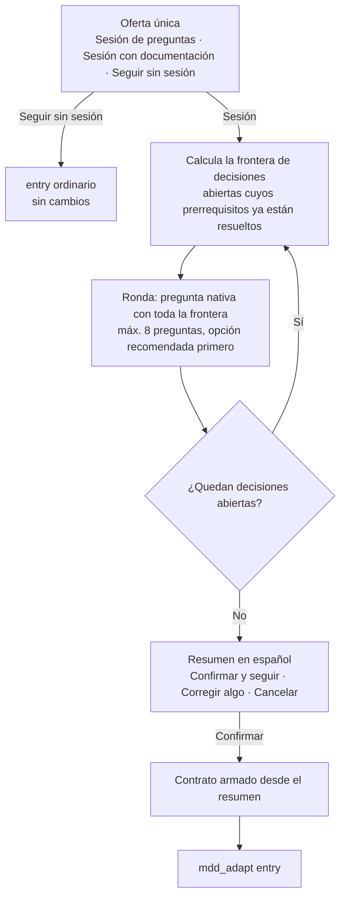

- **Hechos frente a decisiones:** lo que el repositorio puede responder se lee o se explora
  primero, nunca se le pregunta al usuario. Al usuario solo se le preguntan decisiones.
- **Opciones de cada pregunta:** de 2 a 6, con la recomendada primero y marcada `(Recomendada)`.
  Tras cinco rondas, el coordinador pregunta si seguir o cerrar con lo pendiente.
- **Del resumen al contrato:** cada decisión va a `decisions[]`, lo que queda fuera de alcance a
  `exclusions[]`, el comportamiento acordado a `acceptance.requirements[].scenarios`
  (given/when/then) y solo lo que sigue genuinamente abierto a `productQuestions`.
- **Con documentación:** los términos del glosario y las decisiones difíciles de revertir se
  convierten en un requisito y una asignación más. Apply escribe `GLOSSARY.md` o los ADR
  (`docs/adr/NNNN-slug.md`) dentro de `scope.writes`, y Verify los revisa. La sesión en sí no
  escribe nada.
- **Solo aclara:** las respuestas no conceden modo, aprobación ni consentimiento de operaciones.
  Después MDD pide el modo (si no está configurado) y, en modo interactivo, las aprobaciones de
  siempre.
- **Mismo turno:** las rondas usan la herramienta nativa `question` en el mismo turno, porque
  así `entry` se vincula a tu último mensaje sin preguntas extra. Si contestás en el chat en vez
  de en el formulario, no hace falta reenviar nada: el pedido original sigue siendo el objetivo y
  MDD pide una confirmación nativa antes de admitirlo.

| Límite | Comportamiento |
|---|---|
| La conversación tiene una ejecución v3 **cerrada** | La sesión funciona normalmente antes del próximo pedido |
| La conversación tiene una ejecución **activa** | MDD rechaza preguntas que no emitió, así que no se ofrece sesión. Se puede abrir en una conversación nueva |
| Historial legible | `entry` lee los últimos 100 mensajes nativos. Una sesión tan larga que deja el pedido fuera de esa ventana se rechaza sin crear ejecución |
| Pregunta de la sesión descartada o rechazada | La sesión termina sin reintentos y el `entry` ordinario sigue disponible |

`mdd-grill` es una adaptación MIT de las skills `grilling` y `domain-modeling` de
mattpocock/skills, y su `NOTICE` viaja con ella.

### Versión 2: ruta fija de compatibilidad (`mdd_start`)

La política es `mdd-routing-v2`, **sin puntaje**: toda ejecución empieza con exactamente un
`mdd-explore`, se detiene en `mdd-risk`, y un veredicto validado de riesgo elige la continuación.

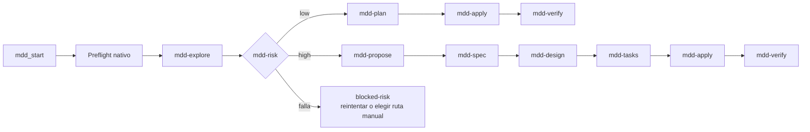

| Ruta | Fases en orden |
|---|---|
| Low | `mdd-explore`, `mdd-plan`, `mdd-apply`, `mdd-verify` |
| High | `mdd-explore`, `mdd-propose`, `mdd-spec`, `mdd-design`, `mdd-tasks`, `mdd-apply`, `mdd-verify` |
| Low legado (solo ejecuciones viejas registradas) | `mdd-plan`, `mdd-apply`, `mdd-verify` |

- `mdd-risk` es un actor configurable, **no una fase**. Su veredicto trae `route` y `complexity`
  (`low` o `high`, y deben coincidir), un `reason`, de 1 a 32 evidencias y hasta 32 riesgos. Si no
  reporta riesgos, tiene que justificarlo.
- La respuesta de certeza del preflight le llega a `mdd-risk` como lo que el usuario dice sobre la
  claridad de los requisitos: **se sopesa, nunca se obedece**.
- Antes de la primera aprobación de la cola, el usuario puede forzar la otra ruta. El origen de la
  ruta queda registrado como `suggested`, `override` o `manual`.
- Una ejecución conserva la ruta con la que arrancó. Al reanudarla no se reevalúa con la política actual.

---

## Actores (agentes)

Se instalan 14 agentes en `<raíz OpenCode>/agents/`. Ninguno fija un modelo en su frontmatter: los
modelos salen del perfil activo (ver [Configuración](#configuración)).

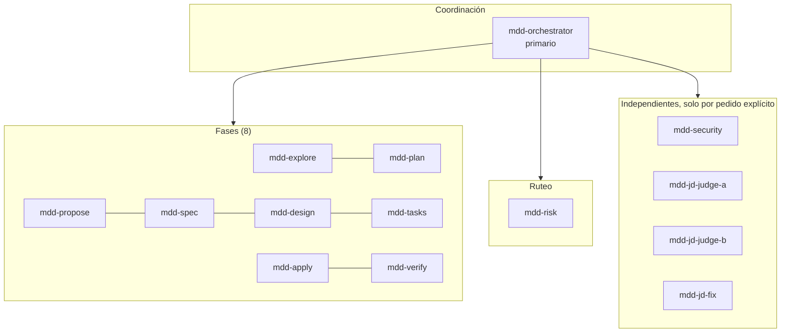

| Agente | Rol | Herramientas en runtime |
|---|---|---|
| `mdd-orchestrator` | Coordinador opt-in: preflight nativo, aprobaciones, despacho de fases, memoria de progreso. Siempre le habla al usuario en español | Todas las `mdd_*` y `question: allow`; el resto según tus permisos |
| `mdd-explore` | Investiga el código o la pregunta y reporta hallazgos concretos | Permisos nativos; sin `task` ni `skill`; `mdd_check_report` |
| `mdd-risk` | Evalúa complejidad y riesgo a partir del pedido y de la exploración; recomienda low o high | Ídem |
| `mdd-plan` | Convierte requisitos y exploración en un plan compacto y verificable | Ídem |
| `mdd-propose` | Define intención, alcance y exclusiones (ruta high) | Ídem |
| `mdd-spec` | Requisitos y escenarios verificables | Ídem |
| `mdd-design` | El diseño mantenible más chico para el comportamiento especificado | Ídem |
| `mdd-tasks` | Tareas ordenadas y verificables (de 1 a 32 entregables) | Ídem |
| `mdd-apply` | Implementa el cambio autorizado y reporta lo que realmente cambió | Ídem, más `mdd_worker_edit` cuando trabaja como worker acotado |
| `mdd-verify` | Ejecuta los checks autorizados y reporta evidencia **sin reparar fuentes** | Ídem |
| `mdd-security` | Auditoría de seguridad de solo lectura sobre un snapshot fijado | Solo `mdd_check_report` |
| `mdd-jd-judge-a` / `-b` | Jueces ciegos de solo lectura para Judgment Day | Solo `mdd_jd_inspect` |
| `mdd-jd-fix` | Correcciones acotadas de hallazgos severos que ambos jueces confirmaron | read/glob/grep; edit y bash con `ask` |

**Delegación y fallback:** cada fase se delega hasta 3 veces (`DELEGATION_ATTEMPTS`). Si se agotan
los intentos, MDD emite **una** tarea de fallback rastreada (`explore` para investigar, `general`
para trabajo de fase autorizado). El orquestador nunca hace el trabajo sustantivo de una fase en su
propia conversación.

**Skills empaquetadas:**

| Skill | Se ofrece a | Para qué |
|---|---|---|
| `mdd-cleanup` | Apply | Limpieza acotada, abstracciones redundantes, sobreingeniería |
| `mdd-doc` + `cognitive-doc-design` | Explore, Plan, Propose, Spec, Design, Verify | Artefactos fáciles de escanear y verificar |
| `mdd-pr-body` | Coordinador | Cuerpo del PR en español con plantilla fija |
| `mdd-judgment-day` | Coordinador | Protocolo de Judgment Day y su referencia de prompts y formatos |
| `mdd-grill` | Coordinador | Sesión de preguntas por rondas antes de un `entry` de evaluación high, o cuando el usuario pide que le pregunten primero (adaptación MIT, con `NOTICE`) |

`cognitive-doc-design` es material Apache-2.0 de terceros (con su `NOTICE`) y **nunca** se instala
en el directorio compartido de skills, porque ese nombre ya suele estar ocupado.

### Formato del reporte de fase

Cada actor responde en markdown, nunca con un objeto JSON suelto:

~~~markdown
## MDD Outcome
passed

## MDD Summary
Prosa breve del resultado.

## MDD Approach
## MDD Purpose
## MDD Open Items
## MDD Learnings
## MDD Confidence

## MDD Artifact
El entregable completo de la fase.

## MDD Data
```json
{ "...": "campos estructurados de la fase, solo donde corresponde" }
```
~~~

Secciones opcionales: `## MDD Concerns` y `## MDD Questions` (como máximo 8 preguntas). Si el
reporte se rechaza solo por la forma, el orquestador lo reescribe con `mdd_phase_result` sin
repetir el trabajo ni gastar un intento. Hay hasta 3 reescrituras de reportes malformados.

---

## Preflight, modos y aprobaciones

### Preflight

Los nuevos runs nativos preguntan **solo los campos que faltan**, todos en una única pregunta nativa
agrupada, más una nota opcional (**Notas**) en tus propias palabras. El almacenamiento **nunca** se
pregunta: se resuelve solo.

| Campo | Opciones (etiqueta → token) | Para qué sirve |
|---|---|---|
| `certainty` (Certeza) | Muy seguro → `very-sure` · Algo seguro → `somewhat-sure` · Poco seguro → `not-sure` | `mdd-risk` lo sopesa junto con la exploración; por sí solo nunca elige la ruta |
| `mode` (Modo) | Interactivo → `interactive` · Automático → `automatic` | Si las fases siguientes esperan aprobación |
| `summary` (Resumen) | Detallado → `detailed` · Medio → `medium` · Bajo → `low` | Qué secciones del reporte se muestran |
| `artifactStore` | Solo resuelto: `engram` o `local` en runs nuevos; `openspec`, `both` y `none` son legado | Backend congelado de artefactos y progreso |
| `complexity` | Legado | Se acepta y se ignora: el riesgo juzga la complejidad después de explorar |

- **Perfil completo:** si el perfil tiene todas las respuestas, no se pregunta nada. Las dudas
  genuinas del coordinador igual se preguntan antes de la primera fase.
- **Precedencia:** elección actual → preferencia de la misma conversación → perfil congelado → preguntar.
  Solo `mode` y `summary` se recuerdan por conversación, en `.mdd/preferences-<sha256>.json`, y
  nunca equivalen a una aprobación.
- **Respuestas escritas:** si contestás con tus palabras (dentro del formulario o en el chat después
  de cerrarlo), el orquestador lo registra con `mdd_answer`. MDD verifica que cada opción elegida
  aparezca en tu texto y que no aparezca ninguna otra.

### Interactivo frente a automático

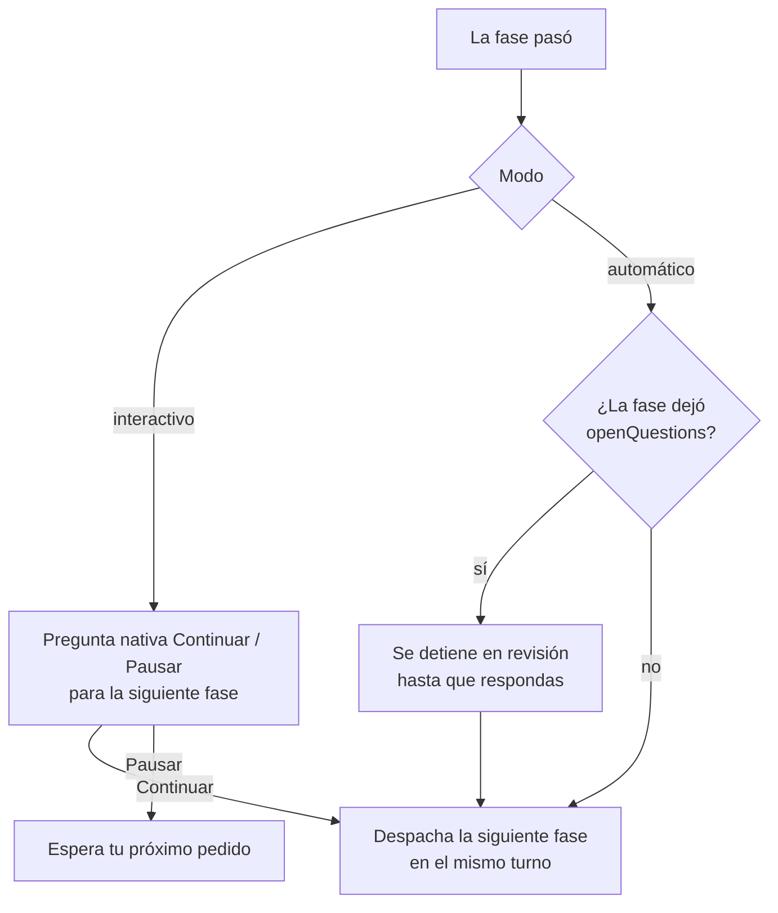

- **Permisos nativos en ambos modos:** ninguno de los dos suprime los pedidos de permiso de
  edición o shell.
- **Lotes de Apply:** solo se aprueba al entrar a Apply y al entrar a Verify, no lote por lote.
- **Aprobación solo por pregunta nativa:** tu prosa no es un canal de consentimiento. Un mensaje
  escrito antes de que se muestre la pregunta no aprueba nada.
- **Aclaraciones:** se juntan en una sola interacción (`mdd_prepare_advance`).
  - Cada una lleva `header` (máx. 30 caracteres), `why`, de 0 a 6 opciones, `multiple` y `deferrable`.
  - Siempre están disponibles "Que decida el agente" y el texto libre.

### Nivel de detalle del reporte

| `summary` | Secciones visibles |
|---|---|
| `low` | Resumen |
| `medium` | Resumen, Propósito, Aprendizajes clave |
| `detailed` | Resumen, Cómo se hizo, Propósito, Pendiente o incierto, Aprendizajes clave, Confianza, Estado |

"Confianza" es el nivel que declara el propio actor, no una probabilidad medida. La cobertura de
evidencia interna (requisitos 20, plan 20, implementación 25, checks 35) decide si una ejecución
puede cerrarse como completa, pero **no** es una probabilidad de corrección ni aparece en los reportes.

---

## Verificación y retrabajo

`mdd-verify` compara el resultado con cada escenario, paso y decisión del plan (formato estructurado
`verificationVersion: 1`):

- **Disposición de checks:** cada check retenido recibe exactamente una: `passed`, `failed`, `ran`,
  `blocked`, `not-applicable`, `replaced` o `environmental`.
- **Estado de cada fila:** `verified`, `not-verified` o `deviation`, con un `cause` opcional
  (`implementation`, `design`, `requirements` o `verification`). Un escenario declarado externo puede
  quedar `external`.
- **Fallos que bloquean:** un check obligatorio que falla o se omite no puede dar PASS. Los fallos
  opcionales quedan visibles.
- **Solo bloquea lo que causó el cambio:** un check que falla por algo ajeno al cambio (se cae por
  carga y pasa al correrlo solo, o ya fallaba igual en la base sin el cambio) se reporta
  `environmental`, con su intento fallido y una ejecución que lo corrobora. No bloquea y siempre
  aparece en el cierre, en el ledger y en el cuerpo del PR. Que falte un test de regresión no es una
  brecha si la propia sonda de Verify demuestra el comportamiento: queda como límite.
- **Evidencia externa:** un escenario que solo se puede observar fuera del workspace (un
  dispositivo, staging o producción, un servicio externo en vivo, un worker real o una persona) se
  declara `evidence: "external"` al planificar. Verify lo reporta `external`, con qué revisar, dónde y
  cómo: queda como **pendiente externo**, no como falla. Nada que no se haya declarado así al
  planificar puede reclasificarse después.
- **Vínculos de decisiones derivados:** si un plan omite o equivoca qué decisión aplica a qué
  entregable, MDD lo corrige solo en vez de rechazar el reporte. La cobertura de escenarios, las
  dependencias y los IDs sí se siguen rechazando.
- **Requisitos no cumplibles:** Plan, Design y Tasks deben declararlos (`unmet`). Un reporte que
  pasa y nombra un requisito no cumplido se rechaza (`UNMET_PASS`).
- **`mdd_check_report` revisa también los vínculos:** cuando la ejecución (ruta fija) está en la
  fase del reporte, el actor ve en su propia sesión los mismos errores de vínculos que vería el
  runner al recibirlo (un vínculo inventado, un escenario sin cubrir), antes de devolverlo.

### Qué pasa cuando Verify falla (ruta fija)

**En modo automático, MDD corrige solo, con un límite.** Cuando Verify encuentra fallas de la
implementación, MDD manda la ruta a una única pasada de corrección de `mdd-apply` para todos los
hallazgos. El Verify siguiente revisa **solo esos hallazgos**: conserva las filas que ya estaban
verificadas y las vuelve a atar a los checks nuevos, que se corren igual completos para detectar
regresiones. Un problema nuevo fuera de los hallazgos queda como seguimiento en los límites y no
gana otra pasada. Hay una segunda pasada solo si la primera cerró hallazgos sin abrir otros.
Después, o si la causa es de diseño o de requisitos, o en modo interactivo, la ejecución se detiene
y decidís vos. El límite se configura con `verify.automaticCorrections` (de 0 a 2, por defecto 2).
Con 0 se vuelve al comportamiento manual.

Cuando la ejecución se detiene, el orquestador te presenta los destinos de retrabajo
(`status.reworkTargets`), la recomendación de MDD (`status.reworkable` y `status.reworkReason`) y
vos elegís. Una corrección que elegís vos también termina en un Verify que revisa solo sus hallazgos.

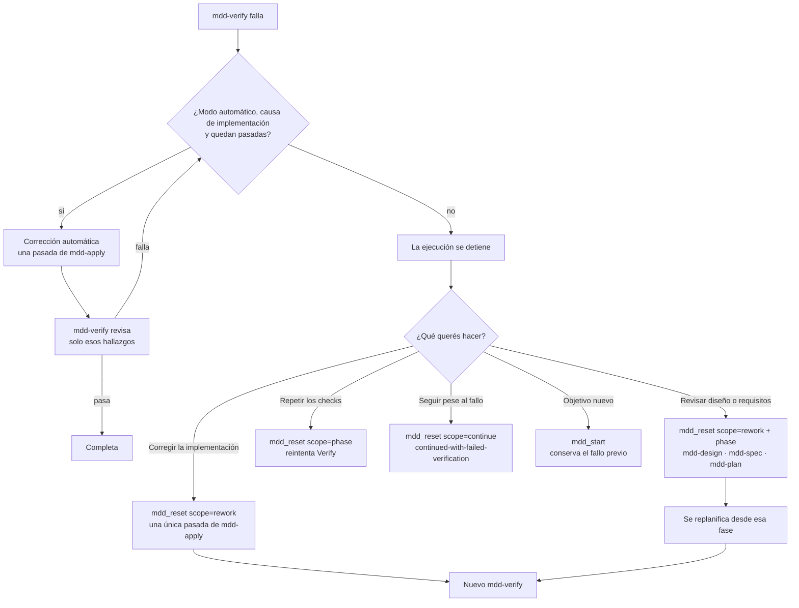

| Causa que atribuye Verify | Destino recomendado (high) | Destino recomendado (low) |
|---|---|---|
| `implementation` (o sin causa) | `mdd-apply` | `mdd-apply` |
| `design` | `mdd-design` | `mdd-plan` |
| `requirements` | `mdd-spec` | `mdd-plan` |
| El mismo requisito vuelve a fallar después de una corrección | Rediseño | `mdd-plan` |

Reglas de la corrección:

- **Una sola pasada:** después de un Verify fallido, un único actor Apply (nunca workers) completa
  todos los entregables restantes en el orden del plan.
- **Sondas de reproducción:** Verify guarda sus sondas con el comando exacto en
  `.mdd/probes/<runID>/`. La corrección tiene que ver fallar cada sonda antes de tocar código.
- **Cierre de hallazgos:** la corrección reporta `closure=[{id,status,evidence}]` para cada hallazgo
  estructurado. Si queda alguno abierto, no puede pasar (`OPEN_CLOSURE_PASS`).
- **Retrabajo de planificación:** libera el plan retenido y la evidencia de checks, y conserva
  resultados, artefactos y archivos cambiados.
- **Continuar pese al fallo:** `continued-with-failed-verification` **no es PASS**. Se archiva en
  `.mdd/run-<hash>.continued.json`, y `mdd_pr_body({ runID })` lo sigue mostrando con `verified: false`.

En la versión 3 el equivalente es una **reparación explícita** (`select` con `repairOf`) que apunta
al último recibo de Apply, seguida de un nuevo Verify estructurado. Cuando la evidencia falla sobre
trabajo completo, `mdd_status` publica `correction` con las asignaciones reparables, cuántas
reparaciones lleva cada una y una instrucción con el mismo límite: en modo automático el
orquestador repara sin preguntar (hasta dos por asignación, la segunda solo si hubo progreso); si no,
te presenta las brechas una vez y elegís entre reparar o cerrar sin verificar con cada brecha como
límite.

---

## Workers paralelos y lotes de Apply

Los planes grandes se parten en **de 1 a 32 entregables** acotados y ordenados por dependencias. No
hay un límite artificial de líneas cambiadas.

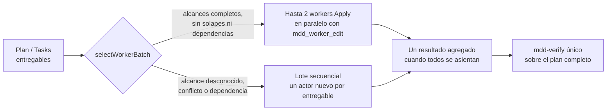

| Aspecto | Regla |
|---|---|
| Preferencia | `workers.enabled` (por defecto `true`), global. Se cambia con `mdd-ai workers on\|off` o desde el editor; requiere reiniciar |
| Concurrencia | Como máximo 2 workers por fase de exploración o de Apply. Verify siempre es uno solo |
| Elegibilidad | Cada entregable declara `dependsOn` y `parallel: {complete, reads, writes}` con rutas exactas. No puede haber solapes escritura/escritura ni escritura/lectura; las lecturas compartidas sí se permiten |
| Exploración paralela | Exactamente 2 `workItems` completos e independientes: `{id, purpose, dependsOn, independent, complete, reads:[{root, files}]}`. Solo `read` sobre archivos declarados y `grep` literal |
| Edición acotada | `mdd_worker_edit`: operaciones `create`, `replace`, `edit` y `delete`, como máximo 16 operaciones y 256 KiB. Conserva modo, BOM y CRLF. No es una transacción multiarchivo ni un sandbox del sistema operativo |
| Fallos | Una escritura fallida, interrumpida o ambigua detiene la ejecución. **Nunca** hay reintento automático de un escritor incierto |
| Reanudación | Los lotes pendientes no se reanudan ni se transfieren: quedan como datos de solo lectura |

---

## Almacenamiento, memoria y el directorio `.mdd`

### Cómo se elige el backend

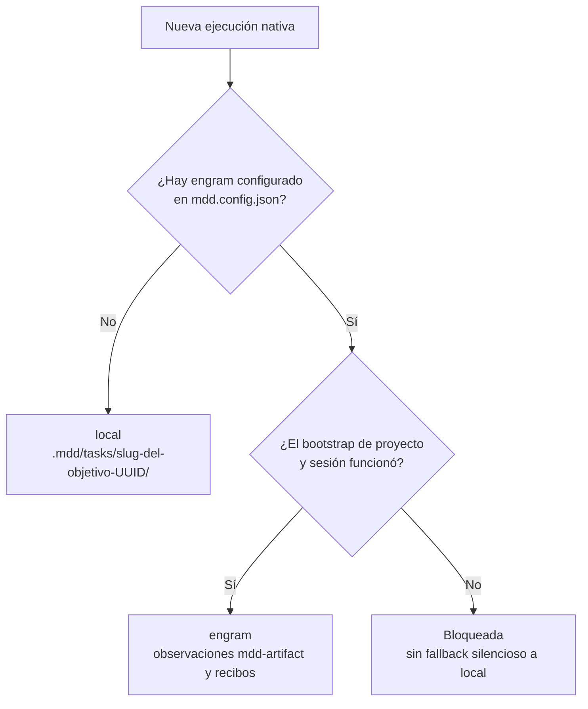

- **Ejecuciones existentes:** las que ya usan Engram, OpenSpec, Both, None o local conservan su
  backend al reiniciar o transferirse. No hay migración.
- **Herramientas MCP:** que haya herramientas MCP de memoria disponibles no activa nada.
- **Dónde mirar:** `mdd_status.storage.backend` y `mdd_status.storage.taskDirectory` muestran el
  backend y la ubicación efectivos.

| Backend | Persistencia del artefacto |
|---|---|
| `local` | Registros inmutables de la tarea y snapshots de progreso completos, con lectura de confirmación obligatoria |
| `engram` | Observación `mdd-artifact` nueva y dedicada, con lectura exacta de confirmación |
| `openspec` (legado) | Archivos exclusivos en `openspec/changes/<runID>/` (`exploration.md`, `plan.md`, `proposal.md`, `specs/<dominio>/spec.md`, `design.md`, `tasks.md`, `apply-progress.md`, `verify-report.md`) |
| `both` (legado) | Primero disco, después Engram; ambos tienen que confirmar |
| `none` (legado) | Sin E/S dedicada; el contenido vive en la respuesta en curso y en el dossier |

### Memoria opcional (Engram)

- **Apagada por defecto.** Si omitís `engram` en la configuración, no hay HTTP, no se arranca
  ningún servicio y no se registra ninguna sesión.
- **Endpoint:** `{"endpoint": "http://127.0.0.1:7437"}`, solo loopback.
- **Gestionada localmente:** `{"mode": "local", "binary": "<ruta absoluta>", "dataDirectory": "<ruta absoluta>"}`.
  - Usa un Engram 1.20.0 ya instalado y aprobado, que MDD arranca de forma diferida en un puerto
    loopback libre.
  - Los datos van por defecto a `<raíz OpenCode>/mdd/memory`, separados de tu historial de Engram.
- **Instalación automática** (solo Windows x64/arm64) desde la release oficial
  `Gentleman-Programming/engram` v1.20.0, con SHA-256 fijados y límites de host, redirección, bytes
  y tiempo. Nunca reemplaza un Engram existente.
- **Recibos:** con memoria activa se guardan recibos compactos (resumen y referencia al artefacto,
  nunca el artefacto completo). La memoria también es la fuente canónica del
  [conocimiento del proyecto](#conocimiento-del-proyecto).
- **Proyecto:** el campo `project` está obsoleto y se ignora con un aviso. El proyecto se resuelve
  solo a partir del workspace activo; los worktrees enlazados se vinculan al repositorio dueño.

### Contenido de `.mdd/`

`.mdd` vive en la **raíz del repositorio** (los worktrees enlazados se resuelven por
`.git` → `commondir`, así que todos comparten el mismo). Se crea de forma diferida con su propio
`.gitignore`.

```text
.mdd/
├── tasks/<slug>-<run-UUID>/         evidencia completa de la tarea (backend local)
│   ├── manifest.json                identidad congelada, registros con digest y último progreso
│   ├── artifact-<UUID>.md           bytes exactos de cada artefacto (cada reintento es un archivo nuevo)
│   └── snapshot-<UUID>.json         snapshot completo de workflow, checkpoint y dossier
├── checkpoint-<sha256(parentID)>.json   checkpoint sellado para reanudar
├── progress-<sha256(parentID)>.json     marcador de 2 KiB (pending / settled / complete)
├── run-<sha256(parentID)>.json          dossier: evidencia preservada (solo datos)
│   ├── …discarded.json / …continued.json
├── owner-*.json, parent-owner-*.json    propiedad durable (un escritor por ejecución)
├── adaptive-*.json                      diario de las ejecuciones versión 3
├── preferences-<sha256>.json            modo y resumen aceptados en esta conversación
├── probes/<runID>/                      sondas de reproducción que guarda Verify
├── runs.jsonl                           una fila por ejecución terminada (máx. 200)
├── sessions.jsonl                       una fila por conversación del orquestador (máx. 500)
├── lessons.jsonl                        mejoras registradas
├── telemetry.jsonl, telemetry-rollup.json   telemetría local
└── knowledge-cache.json                 caché descartable del conocimiento del proyecto
```

---

## Reanudar, transferir y propiedad de la ejecución

### Después de reiniciar OpenCode

Pedí el estado **en la misma conversación**. La ejecución sigue desde donde quedó asentada.

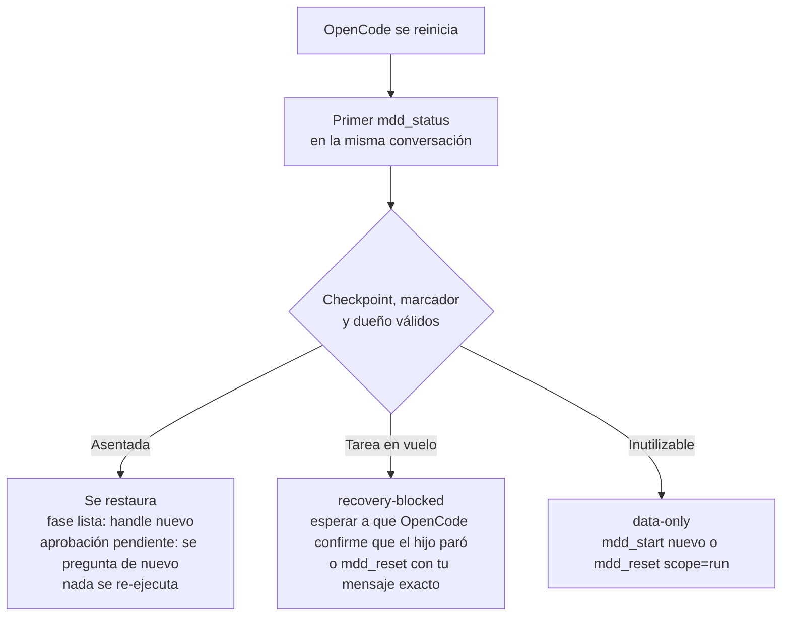

- **Estado del hijo:** `status.liveness` informa lo que ve OpenCode: `stopped`, `running` o
  `unknown`. Un hijo sin actividad durante 2 minutos se considera detenido.
- **Sin repeticiones a ciegas:** las aprobaciones **nunca** se restauran; se vuelven a preguntar.
  Una publicación local incierta bloquea el avance y el reintento automático.
- **Compactación del host:** si OpenCode reemplaza la conversación por un resumen, `mdd_status` trae
  `compacted` y una `runCard` con el objetivo, la ruta, la fase y lo ya registrado. No se pierde nada.

### Continuar en otra conversación

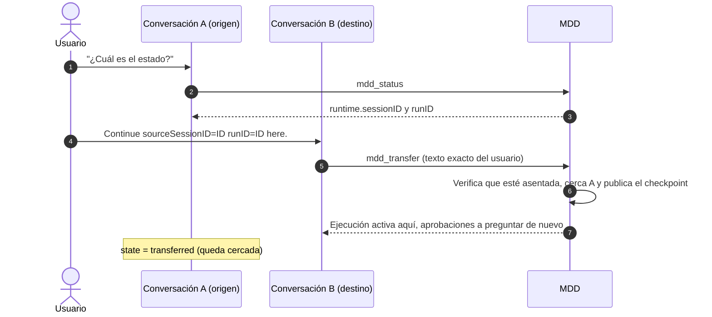

- **Cadenas:** se soportan transferencias encadenadas (A → B → C); los dueños anteriores quedan cercados.
- **Transferencia interrumpida:** se resuelve con `mdd_transfer_recover` (`release-claim`,
  `abort-fenced` o `finish-published`), solo si lo pedís explícitamente.
- **Ejecuciones de otras conversaciones:** si no hay ninguna activa en la tuya,
  `mdd_status.workspaceRuns` lista hasta 6, cada una con su forma de reanudarse: `transfer`,
  `transfer-rework`, `source-conversation` o `finished`.

### Propiedad durable

- **Un escritor por ejecución:** en cada momento hay un solo escritor (tarea nativa, pregunta u
  operación del coordinador), registrado en `owner-*.json`.
- **Identidad del lock:** pid, host, plataforma (WSL o Windows), arranque del sistema y un nonce.
  Un lock de un arranque anterior se reclama; uno del arranque actual, solo si su pid ya no existe.
  Nunca se reclama entre máquinas ni **solo por antigüedad**.
- **Escrituras:** usan renombres atómicos. Una salida incierta queda cercada hasta reconciliarse
  exactamente; nunca se reintenta a ciegas.
- **Descartar:** `mdd_reset scope=run` mueve el dossier a `run-<hash>.discarded.json`. Nunca borra
  artefactos ni memoria.

---

## Funciones independientes

Ninguna de estas funciones es una fase ni se dispara sola: todas necesitan un pedido explícito.

### Auditoría de seguridad (`mdd-security`)

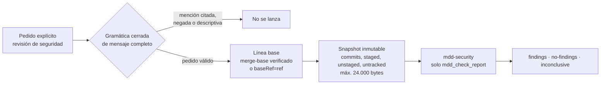

- **Cómo se pide:** "revisión de seguridad", "lanza el agente de seguridad", "usa mdd-security",
  "security audit". Configurar, explicar o mencionar al agente no lo lanza.
- **Línea base:** con `baseRef=<ref>` tiene que ser un ancestro local de `HEAD`; nunca hay fetch remoto.
- **Aislamiento:** el auditor no tiene shell, ni acceso a archivos en vivo, ni red, ni MCP. El
  prompt compuesto tiene como máximo 38.000 bytes; un alcance demasiado grande se rechaza, nunca se
  recorta en silencio.
- **Los hallazgos son consultivos:** cada corrección necesita un consentimiento aparte vía
  `mdd-apply`. `no-findings` **no** certifica que el código sea seguro.
- **Fuera de alcance:** archivos ignorados, binarios, enlaces y submódulos. La redacción de secretos
  es heurística.

### Judgment Day

En `mdd-orchestrator` pedí, por ejemplo:

> **"Run judgment-day on the complete committed change from `<base commit>` to `<target commit>`, including its tests and relevant dependencies."**

También se aceptan `judgment day` y `judment-day`. Una revisión común o un Verify terminado **no** lo disparan.

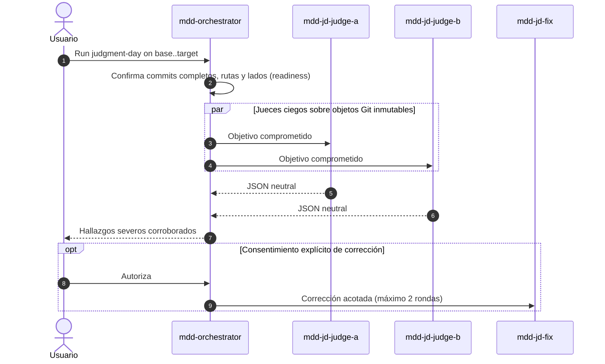

- **Qué inspeccionan los jueces:** solo objetos Git comprometidos, a través de `mdd_jd_inspect`
  (`tree`, `blob` o `diff`), con IDs completos de 40 o 64 caracteres hexadecimales.
  - Cada comando tiene un límite de 128 KiB y 5 segundos.
  - No hay shell, lecturas en vivo, fetch perezoso ni diffs externos.
- **Material sucio o sin seguimiento:** requiere un snapshot comprometido y autorizado por separado.
  Nunca se excluye en silencio.
- **Inspección incompleta:** una inspección malformada, parcial o no disponible no puede dar `APPROVED`.
- **Sin autoridad de entrega:** ningún veredicto autoriza commit, push, PR o release.
- **Modelos:** los roles `mdd-jd-judge-a`, `mdd-jd-judge-b` y `mdd-jd-fix` se configuran en
  `mdd-ai config` → **Modelos**; después hay que reiniciar.

### Cuerpo del PR (`mdd_pr_body`)

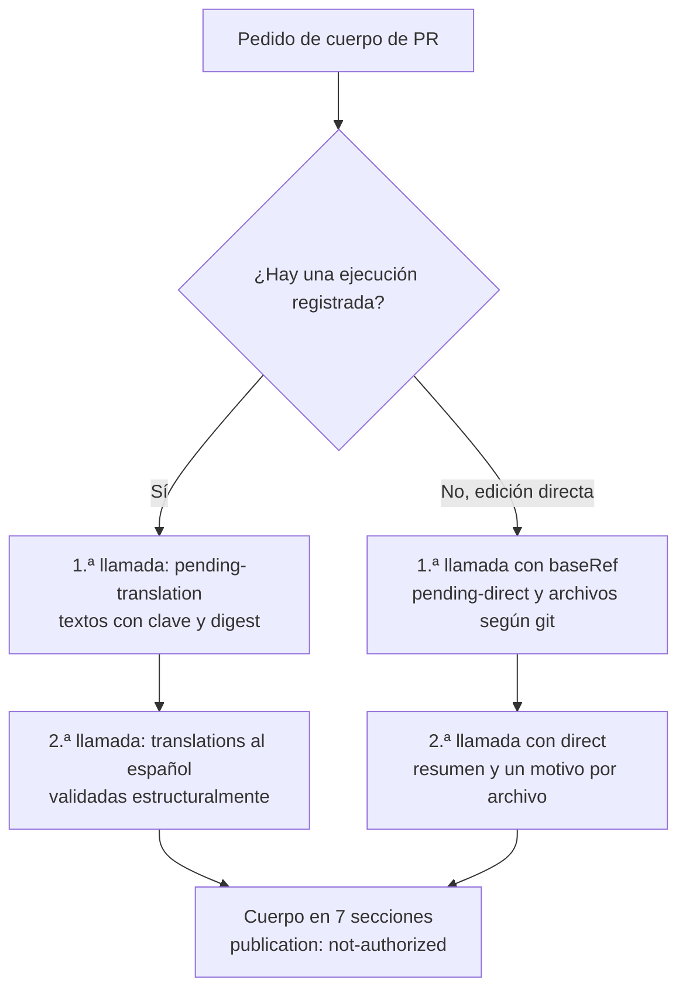

- **Secciones fijas:** Resumen, Cambios (una fila por archivo), Verificación, Variables de entorno,
  Seguimiento, Bloqueos y Despliegue. Lo que falta se escribe como `No aplica.`.
- **Validación de las traducciones:** cada clave aparece una vez y se conservan números, rutas e
  identificadores.
  - La longitud tiene que estar entre 0,5× y 2,5× del original.
  - Después de tres rechazos, el orquestador se detiene.
- **Sin publicación:** redactar no autoriza publicar. Commit, push y PR solo ocurren si los pedís
  explícitamente, y con el cuerpo renderizado sin cambios.

### Conocimiento del proyecto

Reutiliza observaciones validadas del proyecto y skills aprobadas, y las entrega a los actores en
el momento del despacho sin llenar el contexto del coordinador.

| Aspecto | Detalle |
|---|---|
| Activación | `knowledge.enabled`, **encendido por defecto**. Se apaga con `"knowledge": {"enabled": false}` en la configuración global. No existe un switch por CLI ni en el editor |
| Herramientas | `mdd_knowledge` (consulta: resúmenes y referencias, nunca cuerpos) y `mdd_knowledge_record` (registra una observación candidata) |
| Fuente canónica | Engram, observaciones tipo `mdd-project-knowledge`. Sin memoria configurada solo funciona el catálogo de skills |
| Frescura | `fresh`, `stale` o `unverified`: las fuentes se vuelven a hashear contra el checkout en cada consulta. "Fresca" significa que las fuentes declaradas coinciden, no que la afirmación sea verdadera |
| Entrega | Por cada fase o worker, como máximo 3 entradas y 8 KiB, en una sección marcada como "untrusted advisory" |
| Catálogo de skills | Opcional por checkout: `mdd/knowledge.json` con `{version: 1, skills: [{id, path, approved: true, phases, terms, paths, tools}]}` |
| Caché | `.mdd/knowledge-cache.json`: máximo 100 entradas y 512 KiB, descartable |
| Métricas | `mdd_status.knowledge` y el evento de telemetría `knowledge-dispatch` |

Nada se promueve solo a política: el conocimiento es un dato consultivo, nunca autoridad.

### Investigación de solo lectura (`mdd_contextual_explore`)

Una investigación de solo lectura, antes, entre o después de las ejecuciones, sin preflight ni
aprobación. Si hay una ejecución inactiva se vincula a ella con su propio `explorationID`; si no,
corre de forma independiente, sin almacenamiento ni marcador en `.mdd`. Hay una sola por vez, y
nunca autoriza una fase ni una implementación.

### Mejoras, lecciones y retrospectiva

- **Mejoras automáticas:** los intentos fallidos de la ruta principal registran una mejora solos.
- **Mejoras a pedido:** "anotá que…" llama a `mdd_improve`.
- **Revisión desde la CLI:**
  - `mdd-ai lessons report|list|mark|clear` revisa las mejoras (`.mdd/lessons.jsonl`).
  - `mdd-ai retro` arma un informe en español con las ejecuciones terminadas, los fallos y las
    mejoras sin revisar. Abre con **Finalización**: por ruta, qué parte de las ejecuciones terminó
    completa y por qué causa se detuvieron las demás (por ejemplo, defectos de implementación que
    encontró Verify o reportes ilegibles). También muestra cuántas pasaron por corrección, cuántas
    quedaron con pendientes externos y, para la ruta adaptativa, cuántas cerraron verificadas o sin
    verificar.

---

## Herramientas nativas `mdd_*`

El plugin registra **22 herramientas**: 19 son exclusivas del orquestador, `mdd_check_report` y
`mdd_jd_inspect` son para actores, y `mdd_worker_edit` existe solo en el adaptador V2.

| Grupo | Herramienta | Argumentos principales | Qué hace |
|---|---|---|---|
| Estado | `mdd_status` | `detail?` (`compact`, `full` o `rejected`) | Estado, `nextAction`, pregunta pendiente, tareas, almacenamiento, `workspaceRuns`. Solo lectura |
| Versión 3 | `mdd_adapt` | `payload` (JSON `{routingVersion: 3, kind, args}`) | Entrada y operaciones del flujo adaptativo |
| Versión 2 | `mdd_start` | `requirements`, `context?`, `questions?`, `exploration?` | Inicia una ejecución fija de compatibilidad con el texto exacto del usuario |
| Flujo | `mdd_prepare_advance` | `questions` (máx. 8) | Aclaraciones agrupadas antes de despachar o aprobar |
| Flujo | `mdd_revisit` | — | Retira una aprobación o pregunta inactiva para atender una consulta o edición |
| Flujo | `mdd_answer` | `userText?`, `answers[{labels, quote}]` | Registra respuestas escritas con las palabras del usuario |
| Flujo | `mdd_phase_result` | `result` (markdown) | Reescribe un reporte rechazado por la forma; sin reporte rechazado, elige el fallback nativo rastreado (nunca acepta trabajo inline) |
| Flujo | `mdd_reset` | `scope` (`phase`, `run`, `rework` o `continue`), `phase?`, `runID?`, `userText?` | Reintentar, olvidar, retrabajar o continuar tras un fallo |
| Flujo | `mdd_change_request` | `kind` (`rerun` o `material`), `userText`, `requirements?`, `concerns?` | Repetir el preflight o un cambio material de objetivo, integraciones, datos sensibles o permisos |
| Flujo | `mdd_context` | `label`, `content` | Agrega material como dato (no como autoridad) para las fases |
| Flujo | `mdd_contextual_explore` | `purpose`, `workItems?` (máx. 2) | Investigación de solo lectura |
| Transferencia | `mdd_transfer` | `sourceSessionID`, `runID`, `userText` | Mueve una ejecución a esta conversación |
| Transferencia | `mdd_transfer_recover` | `…`, `operationID`, `action` | Resuelve una transferencia interrumpida |
| Independientes | `mdd_security` | `userText`, `baseRef?` | Auditoría de seguridad de un solo uso |
| Independientes | `mdd_pr_body` | `userText`, `runID?`, `notes?`, `digest?`, `translations?`, `baseRef?`, `direct?` | Borrador del cuerpo del PR en dos llamadas |
| Conocimiento | `mdd_knowledge` | `query?`, `phase?`, `paths?`, `limit?` (1–10) | Consulta observaciones con su frescura |
| Conocimiento | `mdd_knowledge_record` | `userText`, `observation` | Registra una observación candidata |
| Mejoras | `mdd_improve` | `userText`, `title`, `detail`, `phase?` | Registra algo que MDD hizo mal |
| Mejoras | `mdd_improvements` | `query?`, `state?`, `limit?` | Informe de las mejoras registradas |
| Actores | `mdd_check_report` | `phase`, `result` | Revisión de forma del reporte (consultiva) dentro de la sesión del actor |
| Actores | `mdd_jd_inspect` | `operation` (`tree`, `blob` o `diff`), `commit`, `base?`, `path?` | Inspección Git inmutable, solo para los jueces |
| Actores | `mdd_worker_edit` | `operations[1..16]` | Ediciones exactas y acotadas de un worker Apply vivo (solo V2) |

Para mantener chico el transcript del orquestador:

- **Handles de despacho:** el prompt de cada tarea viaja como un handle de un solo uso
  (`mdd:dispatch:<uuid>`) que el hook expande, así que el prompt nunca entra en la conversación padre.
- **Respuestas reemplazadas:** las respuestas de estado viejas se colapsan en `{"superseded": …}`.
- **Tope de tamaño:** cada respuesta de estado tiene como máximo 46.000 bytes, recortando campos en
  un orden fijo y sin cortar nunca una tarea.

---

## Instalación en detalle

### Asistente (`npm run setup` o `mdd-ai`)

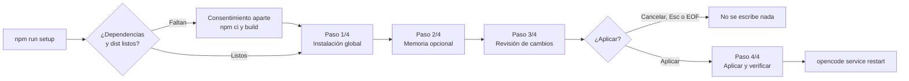

1. **Paso 1/4, Instalación global:** muestra la raíz absoluta de OpenCode y el prefijo propio
   `mdd`. El workspace actual es solo contexto: `OPENCODE_CONFIG_DIR` **no** cambia el destino.
2. **Paso 2/4, Memoria opcional:** dejarla apagada, reutilizar un Engram 1.20.0 compatible o
   instalar uno fijado por separado. Solo aparecen las opciones que aplican.
3. **Paso 3/4, Revisión de cambios:** lista los assets, la configuración, el paquete local y las
   descargas. La confirmación arranca en **Cancelar**; solo **Aplicar** (o escribir `apply`) aprueba.
4. **Paso 4/4, Aplicar y verificar:** instala lo revisado y comprueba la instalación global. No
   arranca OpenCode, modelos ni memoria.

Las listas se manejan con las flechas y Enter, o con el número de la opción. Si algo falla, el
asistente nombra lo pendiente; los cambios ya aplicados se quedan (no hay rollback transaccional).
Un resultado _Ready_ solo prueba la instalación, no el comportamiento con modelos.

### Lo que queda instalado

| Ubicación bajo la raíz de OpenCode | Propósito |
|---|---|
| `mdd/package.json`, `mdd/package-lock.json`, `mdd/node_modules` | Paquete local confiable de MDD y sus dependencias |
| `mdd/packages/` | Tarballs locales direccionados por contenido (se conservan el referenciado y los 3 más nuevos) |
| `mdd/mdd.config.json` | Configuración global: perfiles, modelos, memoria, telemetría, workers, conocimiento |
| `mdd/setup-assets.json` | Hashes de los assets instalados (no es autoridad en runtime) |
| `mdd/bin/` | Lanzadores `mdd-ai` y `mdd-ai.cmd`, y el binario opcional de Engram |
| `mdd/memory/` | Datos opcionales de la memoria gestionada |
| `agents/mdd-*.md` | Los 14 agentes |
| `skills/mdd-cleanup`, `skills/mdd-doc`, `skills/mdd-pr-body`, `skills/mdd-judgment-day`, `skills/mdd-grill` | Skills con espacio de nombres MDD |
| `plugins/mdd.ts` | Cargador relativo de `../mdd/node_modules/my-driven-development/dist/opencode-plugin.js` |
| `cli.json` (entrada en `plugins`) | `./mdd/node_modules/my-driven-development/dist/opencode-tui.js`, fusionada sin tocar otros plugins |

El instalador **no** modifica el `package.json` raíz de OpenCode, `opencode.json(c)`, los
proveedores, el agente por defecto, actores, skills o plugins ajenos, ni el workspace activo.

### Actualizar

```powershell
cd <checkout del código>
npm run build
npm run setup -- update      # o: mdd-ai update
opencode service restart     # cuando no haya trabajo en curso
```

- **Qué hace:** `update` tiene 3 pasos y nunca pregunta por la memoria. Reemplaza el paquete
  desactualizado y los assets propios bajo el mismo **Aplicar**, sin tocar `mdd.config.json`,
  `memory/`, artefactos ni agentes ajenos.
- **Desde dónde:** corrélo desde el checkout que querés desplegar. Desde la copia instalada se
  compara contra sí misma y dice que está todo al día.
- **Cuándo se niega:** con restos `foreign` o assets propios editados a mano
  (`refuses to overwrite different content`).
- **Aviso en runtime:** si los assets instalados quedaron viejos, `mdd_status.assets` lo informa y
  sugiere `mdd-ai update`.

### Diagnóstico (`mdd-ai doctor`)

Solo lectura: revisa el paquete global, los actores, las skills, el cargador, la configuración, la
frescura del paquete (`package-freshness`) y cómo se resolvería el almacenamiento. Imprime
`{ready, scope, checks:[{check, status, message}]}` con `status` en `ok`, `action` o `info`, y
**sale con 1 si no está listo**. Nunca ejecuta el Engram gestionado.

### Migración desde instalaciones por proyecto

Los `mdd.config.json` legados por proyecto (incluido el del checkout) se preservan pero **nunca se
importan solos**. Para migrar, copiá a mano los perfiles validados al archivo global y validalo con
`mdd-ai profile list`. Los cargadores viejos `.opencode/plugins/mdd.ts` pueden cargar MDD dos veces:
quitá solo los assets MDD sin modificar después de comparar su SHA-256. Detalles en
[docs/setup.md](docs/setup.md#legacy-project-migration).

---

## Configuración

Un único archivo global: `$XDG_CONFIG_HOME/opencode/mdd/mdd.config.json` (o
`~/.config/opencode/mdd/mdd.config.json`).

- **Esquema:** [`docs/mdd-config.schema.json`](docs/mdd-config.schema.json). Las claves desconocidas
  se rechazan en todos los niveles y el archivo tiene como máximo 128 KiB.
- **Sin archivo:** leer la configuración nunca crea el archivo, y sin él se usan los valores por defecto.
- **Congelado al arrancar:** el plugin lee la configuración una sola vez. **Cualquier cambio
  requiere reiniciar OpenCode.**

```json
{
  "version": 1,
  "activeProfile": "default",
  "profiles": {
    "default": {
      "models": {
        "orchestrator": "proveedor/modelo-coordinador",
        "mdd-apply": "proveedor/modelo-codigo#high"
      },
      "answers": { "mode": "automatic", "summary": "medium" }
    }
  },
  "telemetry": { "enabled": true },
  "workers": { "enabled": true },
  "knowledge": { "enabled": true },
  "engram": { "endpoint": "http://127.0.0.1:7437" }
}
```

| Clave | Contrato | Por defecto |
|---|---|---|
| `version` | Exactamente `1` | — (obligatoria) |
| `activeProfile` | Nombre seguro que exista en `profiles` | `"default"` |
| `profiles` | De 1 a 64 perfiles; nombres `^[a-zA-Z0-9][a-zA-Z0-9_-]{0,63}$`, sin nombres reservados de Windows | `{ "default": { "models": {}, "answers": {} } }` |
| `profiles.<n>.models` | Rol → `proveedor/modelo[/…][#variante]` (máx. 256 caracteres; `#variante` es el esfuerzo de razonamiento) | Vacío: cada rol omitido hereda la selección **nativa** |
| `profiles.<n>.answers` | Parcial: `certainty`, `mode`, `summary`. `artifactStore` está obsoleto y se ignora en runs nuevos; `complexity` se ignora | Vacío |
| `telemetry.enabled` | Booleano estricto | `true` |
| `workers.enabled` | Booleano estricto (global, no por perfil) | `true` |
| `knowledge.enabled` | Booleano estricto | `true` |
| `verify.automaticCorrections` | Entero de 0 a 2: pasadas de corrección automática tras un Verify fallido (solo modo automático). 0 = siempre decidís vos | `2` |
| `engram` | Omitido = memoria apagada. `{endpoint}` loopback o `{mode: "local", binary, dataDirectory}` | Omitido |

**Roles de modelo configurables (14):** `orchestrator`, `mdd-explore`, `mdd-plan`, `mdd-propose`,
`mdd-spec`, `mdd-design`, `mdd-tasks`, `mdd-apply`, `mdd-verify`, `mdd-risk`, `mdd-security`,
`mdd-jd-judge-a`, `mdd-jd-judge-b` y `mdd-jd-fix`. El plugin aplica solo las sobreescrituras
explícitas y nunca cambia el agente por defecto, el modelo global ni los permisos.

### Editor (`mdd-ai config`)

Editor de terminal en español:

- **Menú:** Perfiles, Modelos, Respuestas de preflight, Memoria (Engram), Telemetría, Workers,
  Guardar y salir, Cancelar.
- **Modelos:** recorre cada rol en tres pasos: proveedor → modelo → variante de esfuerzo opcional.
  Si no hay catálogo de OpenCode, se escribe a mano: Enter conserva el valor y `-` lo borra.
- **Guardado explícito:** nada se escribe hasta **Guardar**. `:cancel`, Esc, EOF o Ctrl+C descartan
  el borrador.
- **Memoria:** el editor solo configura un endpoint o la apaga. La memoria gestionada se configura
  con el asistente de instalación.

---

## Referencia de la CLI

`mdd` y `mdd-ai` apuntan al mismo `dist/cli.js`. Desde un checkout también podés usar `node dist/cli.js …`.

| Comando | Qué hace |
|---|---|
| `mdd-ai` | Abre el asistente de instalación o actualización (requiere una terminal interactiva) |
| `mdd-ai setup` | Asistente de 4 pasos con **Aplicar** explícito |
| `mdd-ai update` | Reemplaza el paquete instalado desactualizado y sus assets (3 pasos) |
| `mdd-ai link` | En Windows agrega `mdd/bin` al PATH del **usuario** (nunca al de la máquina). En otros sistemas imprime la línea `export` |
| `mdd-ai init` | Operación de bajo nivel sobre los assets propios; en uso normal conviene el asistente |
| `mdd-ai doctor` | Diagnóstico de solo lectura (sale con 1 si no está listo) |
| `mdd-ai config` | Editor de configuración avanzado |
| `mdd-ai profile list \| create <nombre> \| use <nombre>` | Perfiles con nombre (`*` marca el activo). `create` también lo activa |
| `mdd-ai workers status \| on \| off` | Preferencia de workers paralelos |
| `mdd-ai telemetry status \| report \| on \| off \| clear` | Telemetría local |
| `mdd-ai lessons report \| list [texto] \| mark <id> \| clear` | Mejoras registradas |
| `mdd-ai retro` | Retrospectiva: ejecuciones, fallos y mejoras |
| `node dist/cli.js --answers <archivo.json>` | Prueba de ruteo (simulación: no ejecuta fases) |
| `node dist/cli.js --profile <archivo.json>` | Igual, con `{ "answers": { … } }` (no es un perfil con nombre) |
| `node dist/cli.js --help` | Ayuda; tiene que ir sola |

Detalles de la prueba de ruteo:

- **Entrada:** pasá exactamente una de `--answers` o `--profile`. Los archivos son JSON UTF-8 (se
  acepta BOM) y las rutas son relativas al directorio actual.
- **Flags heredados:** `--explore` se acepta, pero ya no cambia nada; `--config` se rechaza.
- **Versión de ruteo:** `--routing-version 2` da el mismo resultado que omitirlo. Con
  `--routing-version 3` sale con código 2, porque la versión 3 necesita el contexto nativo de `mdd_adapt`.

```powershell
node dist/cli.js --answers examples/answers.json
```

```json
{
  "policyVersion": "mdd-routing-v2",
  "phases": ["mdd-explore"],
  "reasons": [
    "Every run always starts with exactly one exploration phase before any routing decision.",
    "A validated mdd-risk verdict selects the low or high continuation; the preflight answers are not scored."
  ]
}
```

| Código de salida | Significado |
|---|---|
| `0` | Decisión impresa o ayuda mostrada |
| `2` | Argumentos, JSON, respuestas o perfil inválidos (incluye `--config` y `--routing-version 3`) |
| `1` | Error de E/S o falla inesperada (`doctor` también devuelve 1 si no está listo) |

Los errores salen por stderr como `Error de MDD: <mensaje>` y en ese caso no se emite JSON.

---

## API de librería: kernel y `Workflow`

Después de `npm run build`:

```javascript
import { evaluate } from './dist/kernel.js';

evaluate({ answers: { certainty: 'very-sure', artifactStore: 'none', mode: 'automatic', summary: 'low' } });
// → { policyVersion: 'mdd-routing-v2', phases: ['mdd-explore'], reasons: [...] }
```

- **`evaluate` y `preflight`:** son puras (sin reloj, aleatoriedad, E/S ni inferencia) y validan la
  petición completa.
- **Forma de la petición:** acepta exactamente una de `answers` o `profile: {answers}`, más
  `explore?` y `routingVersion?` opcionales.

`Workflow` es el controlador en memoria de la ruta fija. No forma parte del mapa `exports` del
paquete: se importa por ruta relativa. No persiste nada ni despacha nada; `Workflow.replay`
reconstruye uno a partir de eventos validados (como máximo 512).

```javascript
import { Workflow } from './dist/workflow.js';

const workflow = new Workflow({
  answers: { certainty: 'very-sure', artifactStore: 'none', mode: 'automatic', summary: 'low' },
});

let action = workflow.nextAction();            // { kind: 'execute', phase: 'mdd-explore' }
workflow.start(action.phase);
workflow.recordResult({ phase: action.phase, outcome: 'passed', evidenceSummary: 'Simulado.' });

workflow.nextAction();                         // { kind: 'execute-risk' }
workflow.startRisk();
workflow.recordRiskResult({ outcome: 'passed', evidenceSummary: 'Simulado.', route: 'low' });

workflow.nextAction();                         // { kind: 'execute', phase: 'mdd-plan' }
console.log(workflow.snapshot().routeOrigin);  // 'suggested'
```

Transiciones de `nextAction()` (comprobadas contra `dist/workflow.js`):

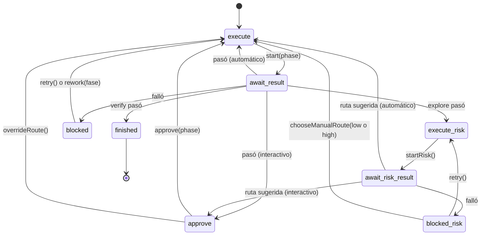

Los tipos `NextAction` son `execute`, `approve`, `await-result` y `blocked` (con `phase`),
`execute-risk`, `await-risk-result` y `blocked-risk` (sin `phase`), y `finished`. Las lecturas no
avanzan el estado.

---

## Telemetría y privacidad

| Aspecto | Detalle |
|---|---|
| Preferencia | Global, `telemetry.enabled` (activada por defecto). Se cambia con `mdd-ai telemetry on\|off` o desde el editor |
| Ubicación | `.mdd/telemetry.jsonl` y `.mdd/telemetry-rollup.json` en la raíz de datos del repositorio |
| Eventos | `preflight`, `phase-start`, `phase-end`, `approval`, `report`, `retry`, `handover`, `reset`, `compaction`, `knowledge-dispatch` |
| Campos | Fase, duración, ruta, resultado, `runID`, intento, modo (`delegate`, `native` o `inline`), ejecutor, clase de fallo, uso de tokens y costo |
| **Nunca se recolecta** | Código fuente, prompts, errores en crudo, rutas, credenciales, modelo/proveedor, entorno |
| Retención | 30 días, máximo 5.000 filas y 1 MiB. El rollup guarda contadores de claves fijas, sin identidad ni texto |
| Exportación | **Ninguna.** Todo queda en tu máquina |

---

## Estructura del repositorio

```text
.
├── src/                 83 módulos TypeScript (se compilan a dist/)
├── tests/               78 suites *.test.mjs, fixtures y smokes de host
├── assets/opencode/
│   ├── agents/          los 14 agentes mdd-*.md
│   ├── skills/          mdd-cleanup, mdd-doc, mdd-pr-body, mdd-judgment-day, mdd-grill, cognitive-doc-design
│   └── mdd-instructions.md   instrucciones inyectadas por valor en cada fase
├── docs/                documentación de referencia (en inglés)
├── examples/            answers.json, profile.json, workflow-demo.mjs
├── scripts/             setup.mjs (lanzador del asistente), extract-engram.ps1
├── odd/tasks/           registros de planificación y entrega de cada funcionalidad
├── AGENTS.md            guía para agentes que trabajan SOBRE este repositorio
└── mdd.config.json      archivo legado del checkout (se preserva, no se importa)
```

### Mapa de módulos por capa

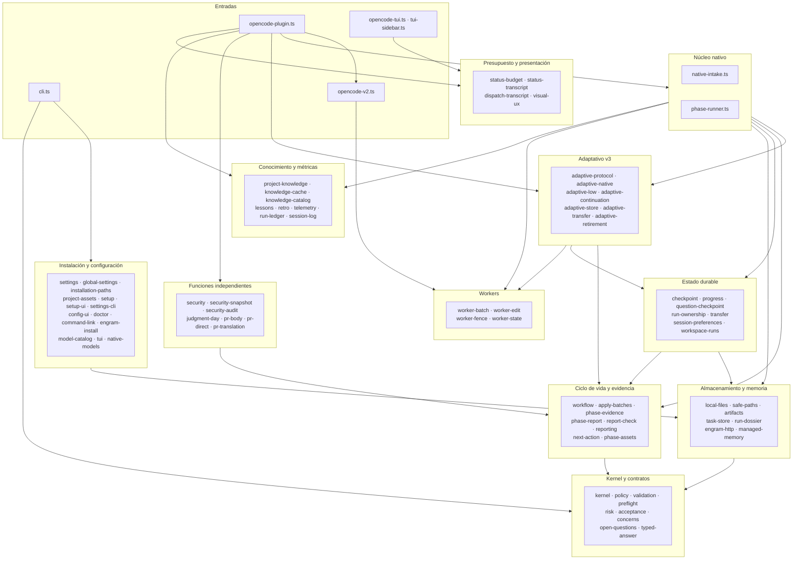

Los módulos más importados son `validation` (48 importadores), `policy` (29) y `local-files` (15).
Los más grandes son `phase-runner.ts` (unos 369 KB), `opencode-plugin.ts` (146 KB),
`native-intake.ts` (121 KB) y `run-ownership.ts` (105 KB).

---

## Desarrollo y pruebas

Corré estos comandos de a uno en PowerShell y seguí solo si el anterior terminó bien:

```powershell
npm ci --ignore-scripts
npm run typecheck
npm test                     # compila (tsc) y corre la suite nativa de Node
node dist/cli.js --answers examples/answers.json
```

| Script | Comando |
|---|---|
| `npm run typecheck` | `tsc --noEmit` |
| `npm run build` | `tsc` |
| `npm test` | `npm run build` y luego `node --import ./tests/isolate-home.mjs --test tests/*.test.mjs` |
| `npm run proof` | `node dist/cli.js` |
| `npm run setup` / `npm run mdd` | `node scripts/setup.mjs` (prepara el checkout y abre el asistente) |

**Infraestructura de pruebas:**

- **Runner:** las pruebas usan `node:test` contra el `dist/` compilado.
- **Aislamiento:** `tests/isolate-home.mjs` aísla HOME, USERPROFILE, `XDG_*`, APPDATA, LOCALAPPDATA y
  la caché de npm en un directorio temporal, así que nunca se toca tu instalación real.
- **Fixtures:** `tests/adapter-fixture.mjs` trae un servidor Engram falso por loopback, reportes en
  el formato real y helpers que llevan una ejecución hasta la parada de riesgo.
- **Suites:** 78 archivos. Las más grandes son `full-native`, `native-intake`, `phase-runner`,
  `opencode-plugin` y `opencode-v2`.
- **Smokes contra un OpenCode real** (manuales, fuera de `npm test`):
  - `tests/opencode-v2-host-smoke.mjs`: herramientas y permisos expuestos; no hace pedidos a modelos.
  - `tests/apply-batches-host-smoke.mjs`: sesiones hijas nativas con un modelo guionado por loopback.
  - `tests/opencode-v2-workers-host-smoke.mjs` (`--exploration-workers`, `--apply-workers`,
    `--formatter-boundary`): este último es un **RED esperado**, porque el formateador nativo de
    2.0.22 saltea el hook.
- **Skips habituales:** 3 pruebas se saltean, dos que necesitan privilegios de symlink en Windows y
  el smoke opt-in de Engram instalado (`MDD_SMOKE_ENGRAM`).

**Último resultado verificado** (commit `943d32a`, Node 26.9.0 en Windows): **2.609 pruebas, 2.606
pasan, 0 fallan y 3 se saltean**, en unos 10,5 minutos. Son pruebas de contrato deterministas, con
SDK simulado y transporte HTTP real por loopback; no ejecutan modelos.

---

## Límites y números clave

| Elemento | Valor |
|---|---|
| Respuesta de estado (`mdd_status` y respuestas de herramientas) | ≤ 46.000 bytes |
| Contexto aportado por entrada / prompt de fase compuesto | ≤ 96.000 bytes |
| Objetivo de despacho de la ruta fija (los artefactos viejos se compactan, del más viejo al más nuevo) | 38.000 bytes |
| Payload de `mdd_adapt` | 160.000 bytes; el contrato y la evidencia no tienen tope propio |
| Pedido del usuario | Sin tope; si no entra en el recibo de Engram, ahí se guarda su tamaño y SHA-256 y el texto completo queda en el checkpoint local |
| Listas del contrato, del plan y de los reportes (requisitos, escenarios, tareas, rutas, archivos cambiados, comandos ejecutados) | Sin tope |
| Página de `detail` | ≤ 6.000 unidades UTF-16 |
| Workers concurrentes | ≤ 2 (exploración: exactamente 2 work items) |
| `mdd_worker_edit` | ≤ 16 operaciones por llamada; sin tope de tamaño de archivo |
| Intentos de delegación por fase / reescrituras de reportes malformados | 3 / 3 |
| Reparaciones v3 / recibos de actor, llamadas y aprobaciones por ejecución | ≤ 4 / sin tope |
| Preguntas: `header` / opciones / preguntas por fase | ≤ 30 caracteres / 0–6 / ≤ 8 |
| Auditoría de seguridad: snapshot / prompt | 24.000 / 38.000 bytes |
| Judgment Day: por comando Git / rondas de corrección | 128 KiB y 5 s / ≤ 2 |
| HTTP de Engram | Solo loopback, 5 s por pedido, ≤ 128 KiB por respuesta, sin reintentos |
| Recibo de Engram (`save()`) | 40.000 bytes, por debajo de los 50.000 caracteres en los que Engram trunca |
| Checkpoint / snapshot de tarea local | 16 MiB / 64 MiB (se detiene en lugar de recortar) |
| Conocimiento por despacho / caché | 3 entradas y 8 KiB / 100 entradas y 512 KiB |
| Telemetría | 30 días, 5.000 filas, 1 MiB |
| `runs.jsonl` / `sessions.jsonl` | 200 / 500 filas |
| Hijo sin actividad considerado detenido | 2 minutos |
| Lock genérico `<ruta>.lock` sin tocar | Se reclama a los 60 s (los locks de dueño nunca por antigüedad) |
| Historial de mensajes consumidos tras un reemplazo | 256 predecesores |
| Archivo de configuración / perfiles | ≤ 128 KiB / 1–64 |

---

## Historial reciente

Todas estas funcionalidades están integradas en `main`. Cuando existe un registro detallado de
planificación y entrega, está en [`odd/tasks/`](odd/tasks).

| Fecha | Funcionalidad | Qué agrega | Registro |
|---|---|---|---|
| 2026-10-28 | Preguntas cortas | Cada pregunta nativa de MDD es corta y su contexto va en el chat (`questionBrief`): aprobación de operación, pedido anterior, decisiones de producto, aclaraciones, ruta, recuperación y cambio; el coordinador y `mdd-grill` hacen lo mismo con sus propias preguntas | [short-native-questions.md](odd/tasks/short-native-questions.md) |
| 2026-10-27 | Verify que termina | Corrección automática acotada con re-verificación solo de los hallazgos; checks `environmental` y escenarios `external` que no bloquean; vínculos de decisiones derivados; `mdd_check_report` con los vínculos de la ejecución; tasa de finalización por causa en `mdd-ai retro`; una aprobación interactiva v3 ya no falla con "Start does not match the actual native caller message" en OpenCode 2 | [verify-completion.md](odd/tasks/verify-completion.md) |
| 2026-10-27 | Entrada adaptativa sin bloqueos | La configuración global de OpenCode ya no frena toda admisión v3; `entry` solo necesita el contrato (vínculo del mensaje, listas vacías y huellas los pone el host); un pedido anterior se confirma con una pregunta nativa; `nextAction` y el coordinador llevan a v3 en vez de `mdd_start` | [adaptive-entry-unblock.md](odd/tasks/adaptive-entry-unblock.md) |
| 2026-10-23 | Sesión de preguntas antes de la admisión | Skill `mdd-grill`: rondas de decisiones antes del `entry` de pedidos grandes, con documentación opcional (glosario/ADR); una ejecución v3 cerrada ya no impide preguntas del coordinador | Commit `97fc1b8` ([docs](docs/opencode-adapter.md#question-session-before-admission)) |
| 2026-10-16 | Retrabajo Apply/Verify | Verify atribuye la causa, el retrabajo puede volver a Design, Spec o Plan, sondas de reproducción, corrección en una sola pasada con `closure` | [apply-verify-rework.md](odd/tasks/apply-verify-rework.md) |
| 2026-10-15 | Flujos adaptativos low/medium/high | Protocolo versión 3 (`mdd_adapt`), low guiado por la necesidad, escalado a medium o high, reemplazo de ejecuciones terminadas | [adaptive-low.md](odd/tasks/adaptive-low.md) |
| 2026-10-14 | Mejoras del preflight | Almacenamiento automático (Engram o local), preferencias por conversación, se elimina la pregunta de almacenamiento | [preflight-improvements.md](odd/tasks/preflight-improvements.md) |
| 2026-10-14 | Traspasos de contexto | Checkout explícito para cada actor y evidencia compacta y verificable entre actores | [context-handoffs.md](odd/tasks/context-handoffs.md) |
| 2026-10-09 | Conocimiento del proyecto | Observaciones con frescura, catálogo de skills aprobadas, activado por defecto | [project-knowledge.md](odd/tasks/project-knowledge.md) |
| 2026-10-09 | Mejoras de los subagentes | Verificación estructurada, continuación explícita tras un Verify fallido | [subagent-improvements.md](odd/tasks/subagent-improvements.md) |
| 2026-10-06 | Workers paralelos | Hasta 2 workers de exploración o Apply con alcance y `mdd_worker_edit` | [parallel-workers.md](odd/tasks/parallel-workers.md) |
| 2026-10-06 | Auditoría de seguridad bajo demanda | `mdd-security` sobre un snapshot inmutable | [on-demand-security-audit.md](odd/tasks/on-demand-security-audit.md) |
| 2026-10-06 | Judgment Day nativo | Dos jueces ciegos, un corrector acotado y la skill empaquetada | [native-judgment-day.md](odd/tasks/native-judgment-day.md) |
| 2026-10-06 | Lotes secuenciales de Apply | Un entregable por actor nuevo, avance automático y Verify al final | [sequential-apply-batches.md](odd/tasks/sequential-apply-batches.md) |
| 2026-10-06 | Aclaraciones completas en español | Sin topes arbitrarios de texto; las preguntas al usuario van en español | [spanish-unbounded-clarifications.md](odd/tasks/spanish-unbounded-clarifications.md) |

---

## Limitaciones conocidas y trabajo pendiente

**Lo que todavía no está validado:**

- No hubo ejecución end-to-end con modelos reales, ni pagos ni gratuitos.
- No se validó la UI de permisos interactiva ni la convivencia con plugins de terceros arbitrarios.
- No hubo una corrida en vivo de la auditoría de seguridad ni de Judgment Day.
- No se midió el ahorro real de tokens.
- La barra lateral y los sonidos no se verificaron visualmente.

**Lo que MDD no garantiza, por diseño:**

- **Atestación:** la evidencia es lo que reportan los actores, revisado por consistencia. No es una
  atestación independiente de que los comandos se ejecutaron, ni prueba de corrección semántica, ni
  una revisión independiente.
- **Sandbox:** no hay. El shell ejecuta código real del proyecto, `mdd_worker_edit` no es una
  transacción multiarchivo y la redacción de secretos de la auditoría es heurística.
- **Recuperación:** no hay recuperación automática ante una caída del proceso ni garantía de
  exactamente una vez. La evidencia se preserva y se informa como datos de solo lectura.
- **Entrega:** MDD no automatiza commit, push, PR ni release.
- **Proveedores:** no hay adaptadores para otros hosts. Claude Code, Pi y Codex figuran solo como objetivos.

**Detalles concretos del repositorio que conviene conocer:**

- **El demo está roto:** `node examples/workflow-demo.mjs` falla con
  `A result must name the current running phase.` porque no maneja la parada de riesgo
  (`execute-risk` / `await-risk-result`). Usá el snippet de
  [API de librería](#api-de-librería-kernel-y-workflow), que sí funciona.
- **Algunos subcomandos no pasan por `npm run mdd`:** `scripts/setup.mjs` no reenvía `workers`,
  `lessons` ni `retro`, así que `npm run mdd -- workers status` falla. Usá `mdd-ai workers status` o
  `node dist/cli.js workers status`.
- **Límite de 5 s en la suite completa:** la prueba de inspección inmutable de
  `tests/judgment-day.test.mjs` puede superar el límite de 5 s de Git cuando la máquina está muy
  cargada. Sola pasa.

---

## Documentación de referencia

| Documento | Contenido |
|---|---|
| [docs/setup.md](docs/setup.md) | Instalación global, `mdd-ai link`, actualización, estructura instalada, migración, seguridad de la memoria |
| [docs/configuration.md](docs/configuration.md) | `mdd.config.json`, perfiles, modelos, workers, Judgment Day, memoria, telemetría, lecciones, APIs de terminal |
| [docs/opencode-adapter.md](docs/opencode-adapter.md) | El adaptador completo: consentimiento nativo, sesión de preguntas, despacho, verificación estructurada, retrabajo, workers, auditoría, PR, reanudación, transferencia y propiedad |
| [docs/product-contract.md](docs/product-contract.md) | Contrato de producto: entradas del preflight, política de ruteo, protocolo versión 3, API del kernel, requisitos diferidos |
| [docs/artifacts-and-actors.md](docs/artifacts-and-actors.md) | `ArtifactStore`, backends, almacenamiento local de tareas, estructura OpenSpec, permisos de los actores |
| [docs/project-knowledge.md](docs/project-knowledge.md) | Conocimiento del proyecto, frescura, caché, catálogo de skills y métricas |
| [docs/mdd-config.schema.json](docs/mdd-config.schema.json) | JSON Schema de la configuración |
| [AGENTS.md](AGENTS.md) | Guía para agentes que trabajan **sobre** este repositorio y skills del proyecto |
