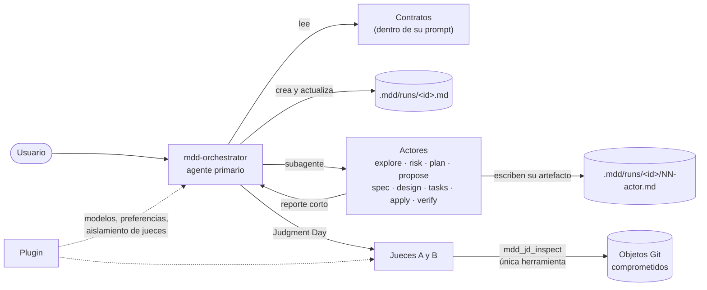
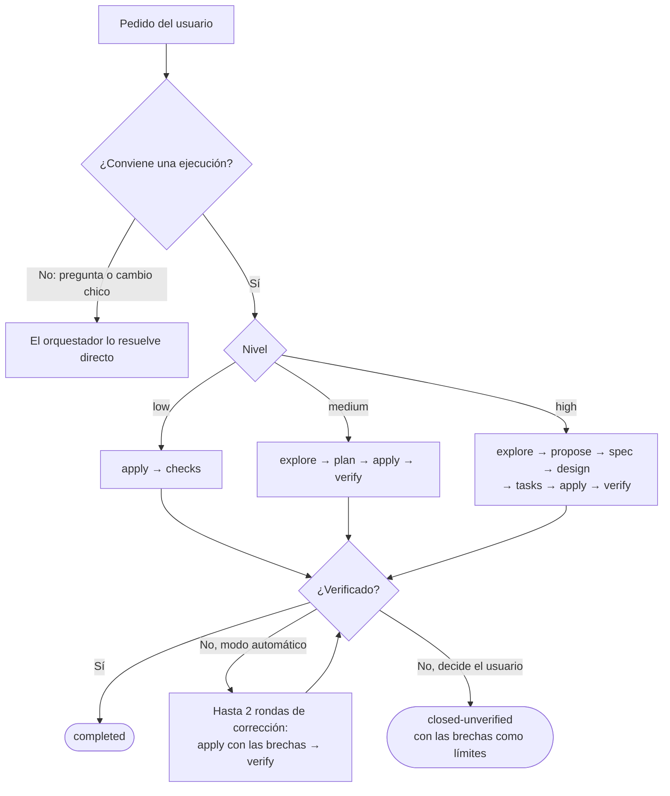

# Arquitectura de MDD

MDD 0.2 es un conjunto de **agentes de OpenCode guiados por contratos en Markdown**, más un
plugin mínimo y un instalador. El orquestador lee los contratos y decide; ninguna herramienta
valida ni rechaza su trabajo. Lo único que se aplica por código es el aislamiento de los jueces de
Judgment Day.

## Componentes

| Componente | Dónde está | Qué hace |
|---|---|---|
| Contratos | `assets/opencode/contracts/` | Las guías: el flujo de trabajo (`workflow.md`), el formato del archivo de ejecución (`run-file.md`) y las reglas comunes de los actores (`actor.md`). |
| Agentes | `assets/opencode/agents/` | Un archivo por actor con su rol. Al instalarse, cada marcador `<!-- mdd:include contracts/… -->` se reemplaza por el texto del contrato, así que cada agente instalado se lee completo por sí solo. |
| Skills | `assets/opencode/skills/` | Procedimientos que se cargan solo cuando se piden: `mdd-grill`, `mdd-pr-body`, `mdd-judgment-day`, `mdd-doc` y `mdd-cleanup`. |
| Plugin | `src/opencode-plugin.ts` | Asigna el modelo configurado a cada agente, agrega al orquestador una línea con las preferencias (`mode`, `summary`) y registra la única herramienta: `mdd_jd_inspect`, solo para los jueces. |
| Instalador y CLI | `src/cli.ts`, `src/setup*.ts`, `src/config-ui.ts`, `src/doctor.ts` | `mdd-ai setup`, `update`, `link`, `doctor`, `config` y `profile`. |

## Por qué contratos y no herramientas

La versión 0.1 confiaba la calidad a un motor de unas 23.000 líneas: 13 herramientas `mdd_*` que
validaban contratos JSON, aprobaciones, alcances, huellas de archivos y la forma de cada reporte.
Cada validación era un punto donde el trabajo podía frenarse, y en la práctica se frenaba:

| Evidencia (registros en [`history/v0.1`](history/v0.1)) | Qué muestra |
|---|---|
| En 8 conversaciones reales, `mdd_adapt` se llamó 30 veces y 24 fueron para leer su esquema de 18 KB. Ninguna ejecución v3 llegó a admitirse. | El protocolo era más difícil de usar que el trabajo mismo. |
| 6 de 14 reportes de actores rechazados en un incidente, por contratos que se contradecían entre sí. | Los rechazos no venían de mal trabajo sino de reglas incoherentes. |
| El motor registraba la evidencia que reportaban los actores, sin certificar que los comandos se hubieran ejecutado. | Gran parte de la validación revisaba la forma de lo que el propio modelo escribía. Una guía clara logra casi lo mismo sin rechazar. |
| Cada arreglo de un bloqueo agregaba más código (casi 2.000 `throw`/`reject` en `src/`). | El costo de mantener las reglas crecía con cada mejora. |

La 0.2 invierte el enfoque: **el agente interpreta guías y nada lo bloquea**. Los permisos
nativos de OpenCode siguen siendo el límite real de lo que un agente puede hacer.

### Qué se pierde y por qué es aceptable

| Antes (0.1, por código) | Ahora (0.2, por guía) | Por qué alcanza |
|---|---|---|
| Aprobación nativa de un solo uso por operación | En modo interactivo, el orquestador pregunta antes de cada actor | La pregunta sigue siendo el formulario nativo de OpenCode; una respuesta clara en el chat también vale. |
| Reanudar desde un checkpoint sellado | Reanudar leyendo `.mdd/runs/<id>.md` | El archivo es legible por personas y por cualquier conversación; no depende del proceso del plugin. |
| Alcance de escritura cercado (`mdd_worker_edit`) | Cada Apply recibe las tareas y archivos que le tocan | Los permisos nativos de edición siguen aplicándose; el cerco no era un sandbox real. |
| Esquema JSON de cada reporte, validado | Reporte corto en Markdown y artefacto en disco | El orquestador lee prosa estructurada; no hay reportes "ilegibles" que rechazar. |
| Memoria Engram gestionada por MDD | Si Engram está instalado como MCP, el orquestador lo usa | MDD no instala ni arranca servicios. |

## Qué se aplica por código y qué es guía

| Regla | Cómo se aplica |
|---|---|
| Los jueces de Judgment Day solo leen objetos Git comprometidos | **Código.** El plugin les niega todos los permisos salvo `mdd_jd_inspect` y quita cualquier otra herramienta de su contexto. La herramienta rechaza cualquier otro agente. |
| `mdd-security` no modifica nada | **Permisos del agente** (frontmatter): lectura y unos pocos comandos `git` de solo lectura. |
| `mdd-jd-fix` pide permiso para editar y ejecutar | **Permisos del agente**: `edit: ask`, `bash: ask`. |
| Todo lo demás (niveles, orden de actores, formato de reportes, verificación, cierre) | **Guía.** Está en los contratos y el orquestador lo interpreta. |

## Flujo de una ejecución

El detalle (cuándo escalar, preguntas, apply en paralelo, reanudación) está en
[`contracts/workflow.md`](../assets/opencode/contracts/workflow.md).

## El archivo de ejecución

Toda ejecución vive en el proyecto, en `.mdd/runs/<id>.md`, con sus artefactos al lado en
`.mdd/runs/<id>/`. Es la única fuente de verdad: pedido textual, criterios de aceptación, alcance,
decisiones, plan, registro, verificación y límites. El orquestador es el único que lo edita; cada
actor escribe solo su propio artefacto. Formato completo en
[`contracts/run-file.md`](../assets/opencode/contracts/run-file.md).

Ventajas frente a un estado interno:

- **Se reanuda desde cualquier lado:** otra conversación, después de reiniciar, o una persona
  leyendo el archivo.
- **Ahorra contexto:** los actores leen los archivos ellos mismos y devuelven un reporte corto; el
  artefacto completo queda en disco.
- **Es auditable:** el registro y la verificación quedan escritos en texto plano.

`.mdd/` es local por defecto: el orquestador crea `.mdd/.gitignore` con `*`. Si querés versionar
las ejecuciones, borrá ese archivo.

## Cómo extender MDD

| Quiero… | Hacé esto |
|---|---|
| Cambiar cómo trabaja el orquestador | Editá `contracts/workflow.md`. |
| Cambiar lo que todos los actores deben cumplir | Editá `contracts/actor.md`. |
| Agregar un contrato nuevo | Crealo en `assets/opencode/contracts/`, sumalo a `MDD_CONTRACTS` en `src/project-assets.ts` e incluilo con `<!-- mdd:include contracts/<nombre>.md -->` en los agentes que lo necesiten. |
| Agregar un actor | Creá `assets/opencode/agents/mdd-<rol>.md` (con el include de `actor.md`), sumá el rol a `MODEL_ROLES` en `src/settings.ts` y al esquema `docs/mdd-config.schema.json`, y mencionalo en `workflow.md`. |
| Agregar una herramienta | Pensalo dos veces: una herramienta solo se justifica si garantiza algo que una guía no puede (como el aislamiento de los jueces). |

Después de cualquier cambio en `assets/`, ejecutá `npm run build` y `mdd-ai update` desde el
checkout, y reiniciá OpenCode.
